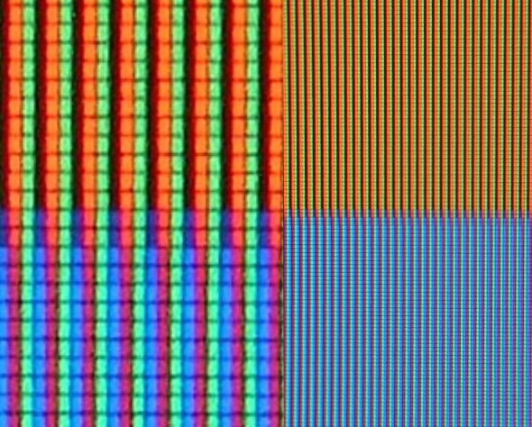
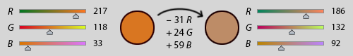

```{r}
#| label: setup
#| echo: false
library(tidyverse)
library(colorspace)
library(patchwork)
theme_set(
    theme_classic() +
    theme(panel.border = element_rect(fill = NA, linewidth = 0))
)
theme_swatch <- theme_void() +
    theme(
        axis.text.y = element_text(hjust = 1, margin = margin(r = 4)),
        plot.title = element_text(size = 10)
    )
set.seed(2026)
```

1. We've been using color in our data visualizations since the very first day of
class. But despite being a topic that most people can informally talk about (and
maybe even encountered in preschool...), what color actually _is_ is a very rich
topic. Learning a bit more about the theory and psychology of color can be
helpful for designing more effective data visualizations.

## Color Theory

### Neuroscience

1. Human vision works through photoreceptor cells called rods and cones. Rod
cells are more sensitive than cones and can detect even a single photon of light
(cones need tens to hundreds before they are stimulated). But they aren't able
to effectively distinguish between photons from different wavelengths, so their
signals can't be used to decode finer color variations. This is why colors
appear subdued at night.

1. Cone cells are sensitive to specific wavelengths and come in three types (L,
M, S) which are sensitive to long, medium, and short wavelengths of light. How
exactly the relative activations of these photoreceptor cells get translated to
perceived color is actually an actively debated topic in neuroscience. But for
our purposes, we'll work with the opponent color channels theory discussed in
the reading. This theory suggests that the signals from these cone cells get
translated into three channels, a red-green, a blue-green, and a luminance
(black-white) gradient.

### Color Spaces

1. Color spaces are attempts to mathematically ``map'' the space of colors that
are perceivable by the human visual system. They provide different ways of
operationalizing ideas like color and luminance, but be mindful that these are
not necessarily perfect matches with how our biology works.

1. The RGB color space decomposes colors into red, green, and blue components.
It associates each color with a point in 3D space.


This system became popular with the rise of television and computer monitors,
which construct color in this way. For example, LCD displays simulate the
appearance of many different colors by using liquid crystals to adjust the
relative backlight passing through red, green, and blue filters.



1. While this is convenient for thinking about how color is constructed on these
devices, it's not very useful for speaking about color in visualization design.
The issue is that simple operations in RGB space don't correspond to easily
explainable changes in the perceived color. For example, suppose we want to
change an orange color to relatively less saturated version. This requires an
unintuitive readjustment of each of the RGB color components (it's not
immediately obvious why we would have to increase blue and decrease red so
much).



1. The need for a more intuitive coordinate system to map out colors has been
appreciated by artists and researchers for a long time. For example, in 1810,
Phillipp Otto Runge created a color sphere where hues were associated with the
polar angle, saturation with the radius, and lightness/darkness with the
$z$-axis. In this spherical geometry, each of the coordinates has a meaningful
perceptual interpretation.

1. There have been many more modern refinements. The most widely used
alternative to RGB in practice is HSL, which stands for Hue, Saturation, and
Luminance. The hue and saturation axes can be visualized using a color wheel,
and modifying the luminance leads to color wheels.

```{r}
#| label: hsl-hsv-wheels
#| fig-width: 6
#| fig-height: 3
#| out-width: "80%"
wheel <- expand_grid(hue = seq(0, 357, by = 3), sat = seq(0.05, 1, by = 0.1))

wheel_plot <- function(colors, title) {
    ggplot(wheel, aes(hue, sat, fill = colors)) +
        geom_tile() +
        scale_fill_identity() +
        scale_x_continuous(limits = c(-1.5, 358.5)) +
        coord_polar() +
        labs(title = title) +
        theme_void() +
        theme(plot.title = element_text(size = 10, hjust = 0.5))
}

wheel_plot(hex(HSV(wheel$hue, wheel$sat, 1)), "HSV (value = 1)") +
    wheel_plot(hex(HLS(wheel$hue, 0.5, wheel$sat)), "HSL (lightness = 0.5)")
```

1. The system is actually derived by transforming the RGB cube. We tilt the cube
so that black and white appear at the top and bottom. We then fill in the gaps
to form an entire cylinder.

<iframe width="1300" height="1452" frameborder="0" loading="lazy" allow="autoplay; fullscreen; picture-in-picture; clipboard-write; web-share" allowfullscreen src="https://commons.wikimedia.org/wiki/File:RGB_2_HSL_conversion_with_grid.ogg?embedplayer=true" />

1. One subtlety is that luminance in HSL doesn't correspond exactly to how we
perceive luminance in our visual system. In the figure below, all the colors
have the same "L" value in HSL, shown in the top row, but in perceptual studies,
people consistently order the perceived luminance according to the bottom row.

```{r}
#| label: hsl-vs-luminance
#| fig-width: 6
#| fig-height: 2
#| out-width: "80%"
hues <- tibble(
    name = c("red", "yellow", "green", "cyan", "blue", "magenta"),
    hue = seq(0, 300, by = 60),
    hsl = hex(HLS(hue, 0.5, 1)),                          # same HSL lightness
    lstar = coords(as(hex2RGB(hsl), "LAB"))[, "L"],       # perceptual lightness
    perceived = hex(LAB(lstar, 0, 0)),                    # just the L* channel, as gray
    label = paste0(name, "\nL* = ", round(lstar))
)

hues |>
    pivot_longer(c(hsl, perceived), names_to = "version", values_to = "color") |>
    mutate(version = factor(version, c("hsl", "perceived"), c("HSL, L = 0.5", "Same colors as L*"))) |>
    ggplot(aes(fct_inorder(label), fct_rev(version), fill = color)) +
    geom_tile(color = "white") +
    scale_fill_identity() +
    scale_x_discrete(position = "top") +
    labs(x = NULL, y = NULL) +
    theme_swatch +
    theme(axis.text.x = element_text(size = 8))
```

1. For this reason, the $L^\ast a^\ast b^\ast$ color space was developed. The
goal was to create a color space that is perceptually uniform, in the sense that
it has been calibrated by to match the luminance judgments made by human study
participants. The bottom row in the plot above gives the $L^\ast$ values
associated with each of the colors in the top row.

1. There's an entire science based around how people perceive color and how we
should represent it theoretically. It could easily be an entire class. Since our
focus is data visualization, let's consider how these aspects of color theory
can influence the use of color as a visual encoding channel.

## Visual Encodings Revisited

1. Luminance, hue, and saturation are each separate visual channels that can be
manipulated to encode data. This gives us much more precise language for
describing the "color channel" that appeared previously in our Howard coding. .

```{r}
#| label: separate-channels
#| fig-width: 6
#| fig-height: 1.8
#| out-width: "80%"
n <- 9
ramps <- bind_rows(
    tibble(channel = "Luminance", step = 1:n,
           color = hcl(260, 40, seq(20, 90, length.out = n))),
    tibble(channel = "Saturation", step = 1:n,
           color = hcl(260, seq(0, 70, length.out = n), 60)),
    tibble(channel = "Hue", step = 1:n,
           color = hcl(seq(0, 320, length.out = n), 50, 60))
)

ggplot(ramps, aes(step, fct_rev(fct_inorder(channel)), fill = color)) +
    geom_tile(color = "white") +
    scale_fill_identity() +
    labs(x = NULL, y = NULL) +
    theme_swatch
```

For example, here is the same variable encoded using each channel.

```{r}
#| label: channels-scatter
#| fig-width: 8
#| fig-height: 2.5
#| out-width: "90%"
pts <- tibble(x = runif(300), y = runif(300), value = x + y)

base <- ggplot(pts, aes(x, y, color = value)) +
    geom_point(size = 1.5) +
    coord_equal() +
    theme(legend.position = "none", axis.text = element_blank(), axis.ticks = element_blank())

(base + scale_color_gradient(low = hcl(260, 40, 20), high = hcl(260, 40, 90)) +
    ggtitle("Luminance")) +
    (base + scale_color_gradient(low = hcl(260, 0, 60), high = hcl(260, 70, 60)) +
        ggtitle("Saturation")) +
    (base + scale_color_gradientn(colors = hcl(seq(0, 320, length.out = 9), 50, 60)) +
        ggtitle("Hue"))
```

1. While luminance is appropriate for encoding ordered data, it's difficult to
tell apart small differences. The reading argues that we should never expect our
audience to be able to tell apart more than five different values of luminance.

```{r}
#| label: luminance-bins
#| fig-width: 6
#| fig-height: 1.8
#| out-width: "80%"
bins <- map_dfr(c(5, 12), \(k) tibble(k = k, step = 1:k, color = gray.colors(k, start = 0.1, end = 0.95)))

ggplot(bins, aes(xmin = (step - 1) / k, xmax = step / k, ymin = 0, ymax = 1, fill = color)) +
    geom_rect() +
    scale_fill_identity() +
    facet_wrap(~k, ncol = 1, labeller = as_labeller(c("5" = "5 gray levels", "12" = "12 gray levels"))) +
    theme_void() +
    theme(strip.text = element_text(hjust = 0, size = 9, margin = margin(b = 4)))
```

This is also very important for thinking about text. A 3:1 luminance ratio
between text and the background is almost impossible to read. The reading
recommends at least a 10:1 ratio.

```{r}
#| label: text-contrast
#| fig-width: 6
#| fig-height: 2
#| out-width: "70%"
relative_luminance <- function(color) {
    rgb <- col2rgb(color) / 255
    linear <- ifelse(rgb <= 0.04045, rgb / 12.92, ((rgb + 0.055) / 1.055)^2.4)
    colSums(linear * c(0.2126, 0.7152, 0.0722))
}

contrast_ratio <- function(a, b) {
    la <- relative_luminance(a)
    lb <- relative_luminance(b)
    (pmax(la, lb) + 0.05) / (pmin(la, lb) + 0.05)
}

# gray text on a white background whose contrast ratio is closest to the target
grays <- gray(seq(0, 1, length.out = 256))
text_color <- function(target) grays[which.min(abs(contrast_ratio(grays, "white") - target))]

tibble(ratio = c(1.5, 3, 10)) |>
    mutate(
        color = map_chr(ratio, text_color),
        label = paste0("Contrast ", ratio, ":1 (", round(contrast_ratio(color, "white"), 1), " achieved)")
    ) |>
    ggplot(aes(0, fct_rev(factor(ratio)), label = label, color = color)) +
    geom_text(hjust = 0, size = 5) +
    scale_color_identity() +
    xlim(0, 1) +
    theme_void()
```

1. Similarly to luminance, saturation can be used for ordered data. But again,
we can only differentiate so many bins, and in fact, the recommended maximum for
this channel is three. Further, there's an interaction between saturation and
the size of the region to which the color is applied. For example, for small
marks, it's difficult to tell apart differences in saturation, and even two bins
can be hard to read. Another rule of thumb is that for small marks, we should
use more saturated colors, while for larger regions, we should use less
saturated colors (pastels).

```{r}
#| label: saturation-size
#| fig-width: 6
#| fig-height: 4
#| out-width: "70%"
cells <- expand_grid(x = 1:12, y = 1:12) |>
    mutate(level = factor(cut(x + y + rnorm(n(), sd = 2), 3, labels = FALSE)))

pastel <- hcl(260, c(10, 20, 30), 75)
vivid <- hcl(260, c(30, 55, 80), 55)

small_marks <- function(palette, title) {
    ggplot(cells, aes(x, y, color = level)) +
        geom_point(size = 0.8) +
        scale_color_manual(values = palette) +
        labs(title = title) +
        theme_void() + theme(legend.position = "none", plot.title = element_text(size = 9))
}

large_marks <- function(palette, title) {
    ggplot(cells, aes(x, y, fill = level)) +
        geom_tile() +
        scale_fill_manual(values = palette) +
        labs(title = title) +
        theme_void() + theme(legend.position = "none", plot.title = element_text(size = 9))
}

(small_marks(pastel, "Small marks, pastel") + small_marks(vivid, "Small marks, saturated")) /
    (large_marks(pastel, "Large regions, pastel") + large_marks(vivid, "Large regions, saturated"))
```

1. Hue is very highly ranked visual channel for telling apart categorical data
values. It's easy to tell the difference in hue for contiguous regions but
harder to tell differences in hue when they're far apart. In a small region we
can tell apart roughly six or seven hues at a time.

```{r}
#| label: hue-count
#| fig-width: 8
#| fig-height: 3.5
#| out-width: "90%"
hue_counts <- c(3, 6, 12, 20)

adjacent <- map_dfr(hue_counts, \(k) {
    colors <- rainbow_hcl(k)
    tibble(k = k, group = 1:k, color = colors)
}) |>
    ggplot(aes(xmin = (group - 1) / k, xmax = group / k, ymin = 0, ymax = 1, fill = color)) +
    geom_rect() +
    scale_fill_identity() +
    facet_wrap(~k, nrow = 1, labeller = label_both) +
    labs(title = "Large, adjacent regions") +
    theme_void() + theme(plot.title = element_text(size = 10))

scattered <- map_dfr(hue_counts, \(k) {
    colors <- rainbow_hcl(k)
    group <- sample(k, 200, replace = TRUE)
    tibble(k = k, x = runif(200), y = runif(200), color = colors[group])
}) |>
    ggplot(aes(x, y, color = color)) +
    geom_point(size = 0.8) +
    scale_color_identity() +
    facet_wrap(~k, nrow = 1, labeller = label_both) +
    labs(title = "Small marks, scattered") +
    theme_void() + theme(plot.title = element_text(size = 10))

adjacent / scattered
```

1. Unlike saturation and luminance, hue doesn't have a natural ordering. Though
it can be applied to ordered data, like with a rainbow color map, these
comparisons requires more cognitive effort. In some settings we've already
learned to associate hue with ordering (e.g., green, yellow, and red on traffic
lights), but this isn't built into our basic perception in the same way that
saturation and luminance comparisons are.

1. Transparency is related to color, and can in principle could be used to
encode ordered data. For example, the largest values can be 0% transparent, the
next largest can be 10% transparent, etc. However, transparency strongly
interacts with luminance and saturation, in the sense that a a fully saturated
but 20% transparent point might be confused with a less saturated but 0%
transparent point. For this reason, transparency encoding should not be used
together with luminance and saturation gradients.

1. The most defensible use of transparency is in differentiating foreground from
background layers. Anything more than two bins becomes difficult to perceive
accurately.

## Color Map

1. To actually use color to encode a data attribute, we need a color map, which
_maps_ from a domain of data values to a range of colors. A first distinction
between color maps is between ordered and categorical color spaces.  For ordered
data, we can think of this as traversing a path through the 3D color space. For
categorical data, this is a selection of points in that space.

1. For ordered variables, we can use either continuous or stepped color maps.
Stepped color maps are segmented into discrete bins.

```{r}
#| label: continuous-vs-stepped
#| fig-width: 7
#| fig-height: 3
#| out-width: "80%"
base <- ggplot(faithfuld, aes(waiting, eruptions, fill = density)) +
    geom_raster() +
    theme(legend.position = "bottom", legend.key.width = unit(1, "cm"))

(base + scale_fill_viridis_c() + ggtitle("Continuous")) +
    (base + scale_fill_viridis_b(n.breaks = 6) + ggtitle("Stepped"))
```

### Categorical Color Maps

1. For categorical color maps, it is important to choose colors that can be
differentiated from one another. A good default is to choose complementary
colors as much as possible (those on opposite sides of the color wheel). There
is some disagreement about the maximum number of colors to use at once, but they
range from 6 - 12.

1. How many colors we can tell apart at once also depends on how much space is
available for showing them. Colors confined to small spaces, we should use fewer
categories. In the first visualization, we can still perceive the 21 different
colors (the fact that they are physically separated also helps). The second has
the same number of colors, but since they are shading in smaller segments, it's
much harder to tell them apart.

1. Considering that we may be able to only distinguish so many colors in a
categorical color map, what should we do with data with many categories? Some
reasonable approaches are,

    - To bin the groups into a smaller number of categories.
    - To group all the rare categories into "other".

```{r}
#| label: many-categories
#| fig-width: 9
#| fig-height: 3.5
#| out-width: "90%"
many <- ggplot(mpg, aes(displ, hwy, color = manufacturer)) +
    geom_point() +
    guides(color = guide_legend(ncol = 2, title = NULL)) +
    labs(title = "15 manufacturers")

lumped <- mpg |>
    mutate(manufacturer = fct_lump_n(manufacturer, 5)) |>
    ggplot(aes(displ, hwy, color = manufacturer)) +
    geom_point() +
    scale_color_manual(values = c(RColorBrewer::brewer.pal(5, "Set1"), "grey70")) +
    labs(title = "Top 5 + Other")

many + lumped
```

1. If it's absolutely necessary to distinguish every category, one option is to
cross another channel along with color. If we had 12 categories, we could show 4
hues $\times$ 3 shapes, instead of 12 separate hues.

```{r}
#| label: color-and-shape
#| fig-width: 8
#| fig-height: 3
#| out-width: "90%"
clusters <- tibble(category = 1:12, angle = 2 * pi * (category - 1) / 12) |>
    mutate(
        cx = cos(angle), cy = sin(angle),
        hue_group = factor((category - 1) %% 4),
        shape_group = factor((category - 1) %/% 4)
    )

pts <- clusters |>
    slice(rep(1:12, each = 12)) |>
    mutate(x = cx + rnorm(n(), sd = 0.12), y = cy + rnorm(n(), sd = 0.12))

base <- ggplot(pts, aes(x, y)) + coord_equal() + theme_void() + theme(legend.position = "none")

(base + geom_point(aes(color = factor(category))) + scale_color_manual(values = rainbow_hcl(12)) +
    ggtitle("12 hues")) +
    (base + geom_point(aes(color = hue_group, shape = shape_group), size = 2) +
        scale_color_brewer(palette = "Set1") + ggtitle("4 hues x 3 shapes"))
```

1. Even with a fixed set of hues, we still have to make a decision about the
luminance and saturation for each hue. There's no universal recipe for setting
this. Sometimes it's recommended to use high luminance contrast across
caetgories. The advantage of this is that the categories can be read apart even
on black-and-white paper. But this can be misleading if it draws too much
attention to the high luminance categories.

1. A good color map resource is ColorBrewer, a set of color palettes created by
Cynthia Brewer for use in spatial data visualization. They have been chosen so
that categories are easy to differentiate. It provides color maps with both high
(Set1) and low (Set2) saturation. It also has high (Set1, Set2) vs. low (Dark1,
Dark2) luminance versions

```{r}
#| label: categorical-luminance
#| fig-width: 6
#| fig-height: 3
#| out-width: "80%"
map_dfr(c("Set2", "Dark2", "Set1"), \(p) {
    tibble(palette = p, index = 1:8, color = RColorBrewer::brewer.pal(8, p))
}) |>
    mutate(grayscale = desaturate(color, 1)) |>
    pivot_longer(c(color, grayscale), names_to = "version", values_to = "fill") |>
    ggplot(aes(index, fct_rev(version), fill = fill)) +
    geom_tile(color = "white") +
    scale_fill_identity() +
    facet_wrap(~fct_inorder(palette), ncol = 1) +
    theme_swatch +
    theme(strip.text = element_text(hjust = 0, size = 9))
```

### Ordered Color Maps

1. There are two types of color maps for ordered data.

   - **Sequential** color maps range from a minimujm to a maximum value.
   - **Diverging** color maps have a meaningful midpoint and must ensure that the the endpoints are different both from one another and from the midpoint.

```{r}
#| label: diverging-maps
#| fig-width: 9
#| fig-height: 3
#| out-width: "95%"
elev <- expand_grid(col = 1:ncol(volcano), row = 1:nrow(volcano)) |>
    mutate(z = as.vector(volcano))
elev_c <- elev |> mutate(z = z - 130)  # deviation from a reference elevation

diverging <- function(midpoint) {
    scale_fill_gradient2(low = "#2166AC", mid = "white", high = "#B2182B", midpoint = midpoint)
}

map_plot(scale_fill_viridis_c(), "Sequential:
reference is invisible", elev_c) +
    map_plot(diverging(0), "Diverging:
midpoint at reference", elev_c) +
    map_plot(diverging(30), "Diverging:
midpoint misplaced", elev_c) +
    plot_layout(nrow = 1)
```

1. Our discussion of luminance and saturation shows that these are well-suited
to defining sequential color maps. Consider fixing a hue. We can obtain an
associated sequential map either by varying saturation (one end will be white)
or luminance (one end will be black). If we ignore hue entirely, then we recover
gray scale.

```{r}
#| label: sequential-maps
#| fig-width: 9
#| fig-height: 3
#| out-width: "95%"

map_plot <- function(scale, title, data = elev) {
    ggplot(data, aes(col, row, fill = z)) +
        geom_raster() +
        scale +
        coord_equal() +
        labs(title = title) +
        theme_void() +
        theme(legend.position = "bottom", legend.title = element_blank(),
              legend.key.width = unit(0.6, "cm"), legend.key.height = unit(0.2, "cm"),
              plot.title = element_text(size = 9), legend.text = element_text(size = 7))
}

map_plot(scale_fill_gradient(low = "black", high = "white"), "Grayscale
(luminance only)") +
    map_plot(scale_fill_gradient(low = "white", high = "#1f78b4"), "One hue,
varying saturation") +
    map_plot(scale_fill_gradient(low = "black", high = "#1f78b4"), "One hue,
varying luminance") +
    map_plot(scale_fill_viridis_c(), "Many hues
(viridis)") +
    plot_layout(nrow = 1)
```

1. Alternatively, we can use multiple hues in a sequential colormap.  The fewer
hues that are considered, the easier it is to perceive global differences. The
more hues that are considered, the more that fine-grained structure is
emphasized. At the extreme, we can use a rainbow color palette. Even though this
makes small differences in the data attribute visible, it can blind us to larger
change, because hues don't have a natural ordering.

(tk: Add the example from Bergman et al. 95).

Another problem is that the scale is not perceptually linear. 1,000 units at one part of the range can go through three different colors while at another range they can look all the same color.

A technical solution to this problem is called monotonically increasing luminence. Show the example from Rogowitz and Trainisch 98.

```{r}
#| label: rainbow-maps
#| fig-width: 8
#| fig-height: 3
#| out-width: "90%"
palette_cols <- list(
    Rainbow = rev(rainbow(100, end = 0.7)),
    Viridis = viridisLite::viridis(100),
    Grayscale = gray(seq(0, 1, length.out = 100))
)

map_plot(scale_fill_gradientn(colors = palette_cols$Rainbow), "Rainbow") +
    map_plot(scale_fill_gradientn(colors = palette_cols$Viridis), "Viridis") +
    map_plot(scale_fill_gradientn(colors = palette_cols$Grayscale), "Grayscale") +
    plot_layout(nrow = 1)
```

The rainbow creates bands that look like discrete steps, but where the bands fall
depends on hue changes, not on the data. Plotting luminance (L\*) along each
colormap shows why: the rainbow rises and falls, while viridis increases steadily.

```{r}
#| label: rainbow-luminance
#| fig-width: 5
#| fig-height: 3
#| out-width: "60%"
imap_dfr(palette_cols, \(cols, name) {
    tibble(palette = name, position = seq_along(cols), lstar = coords(as(hex2RGB(cols), "LAB"))[, "L"])
}) |>
    ggplot(aes(position, lstar, color = palette)) +
    geom_line(linewidth = 1) +
    labs(x = "Position along colormap (low to high)", y = "L*", color = NULL)
```

Bivariate colormaps show two attributes at a time.

For categorical data with multiple levels this doesn't really work well. But it can be okay for sequential and diverging attributes. Some people will have difficulty interpreting this even though they appear often in visualizations.

```{r}
#| label: bivariate-map
#| fig-width: 7
#| fig-height: 3.5
#| out-width: "80%"
# second variable: local steepness of the volcano
shift_rows <- rbind(volcano[-1, ], volcano[nrow(volcano), ])
shift_cols <- cbind(volcano[, -1], volcano[, ncol(volcano)])
slope <- sqrt((shift_rows - volcano)^2 + (shift_cols - volcano)^2)

# 3 x 3 palette; index = (slope bin - 1) * 3 + elevation bin
bi_pal <- c("#e8e8e8", "#ace4e4", "#5ac8c8",
            "#dfb0d6", "#a5add3", "#5698b9",
            "#be64ac", "#8c62aa", "#3b4994")

bi <- elev |>
    mutate(
        slope = as.vector(slope),
        color = bi_pal[(ntile(slope, 3) - 1) * 3 + ntile(z, 3)]
    )

bi_map <- ggplot(bi, aes(col, row, fill = color)) +
    geom_raster() + scale_fill_identity() + coord_equal() + theme_void()

bi_legend <- expand_grid(elevation = 1:3, slope = 1:3) |>
    ggplot(aes(elevation, slope, fill = bi_pal[(slope - 1) * 3 + elevation])) +
    geom_tile() + scale_fill_identity() + coord_equal() +
    labs(x = "Elevation →", y = "Slope →") +
    theme_minimal(base_size = 9) +
    theme(panel.grid = element_blank(), axis.text = element_blank())

bi_map + bi_legend + plot_layout(widths = c(3, 1))
```

Red-green color blindness can affect 8% of the men. About half a percent of the women. To design for a potential colorblind audience, you can use a simulator.

```{r}
#| label: colorblind-simulation
#| fig-width: 7
#| fig-height: 4.5
#| out-width: "80%"
cvd_palettes <- list(
    Rainbow = rainbow(7),
    "Red-green" = RColorBrewer::brewer.pal(7, "RdYlGn"),
    Viridis = viridisLite::viridis(7),
    "Okabe-Ito" = unname(palette.colors(8, "Okabe-Ito")[-1])
)

imap_dfr(cvd_palettes, \(cols, name) {
    tibble(
        palette = name, index = seq_along(cols),
        Normal = cols, Deuteranopia = deutan(cols), Protanopia = protan(cols), Tritanopia = tritan(cols)
    )
}) |>
    pivot_longer(Normal:Tritanopia, names_to = "vision", values_to = "color") |>
    mutate(vision = fct_rev(fct_inorder(vision))) |>
    ggplot(aes(index, vision, fill = color)) +
    geom_tile(color = "white") +
    scale_fill_identity() +
    facet_wrap(~palette, ncol = 2) +
    theme_swatch +
    theme(strip.text = element_text(size = 10))
```


stepped vs. continuous scales
scale manual
scale brewer
factor - other (forcats)
factor - lump
scale gradient
scale gradient 2 (diverging)
scale viridis
scico


avoid geom raster
try sharing themes across
develop a helper functions file

check this: associated sequential map either by varying saturation (one end will be white) ---> shouldn't it be grey?