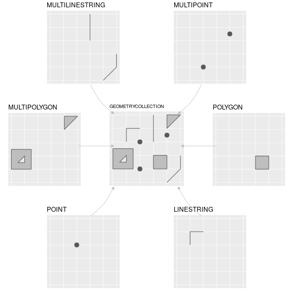

Readings [1](https://r-tmap.github.io/tmap-book/) (Chapter 3), [2 (optional)](https://r.geocompx.org/spatial-class.html) (Chapter 2)

Items marked with $^\dagger$ will not be tested on exams.

```{r}
#| label: libraries
library(ceramic)
library(knitr)
library(raster)
library(sf)
library(spData)
library(terra)
library(tidyverse)
library(tmap)
theme_set(theme_minimal())
terraOptions(progress = 0)
```

### Preview

1. Spatial data come in two main formats: vector and raster. We’ll examine them
in detail soon, but first let's review the high-level distinction and give a
few examples. We'll also see how to read and write data to and from these
formats.

2. Vector data formats are used to store geometric information, like the
locations of hospitals (points), trajectories of bus routes (lines), or
boundaries of counties (polygons). It’s useful to think of the associated data
as being spatially enriched data frames, with each row corresponding to one of
these geometric features.

3. Vector data are usually stored in `.geojson`, `.wkt`, `.shp`, or `.topojson`
formats. Standard data.frames cannot be used because then important spatial
metadata would be lost, like the Coordinate Reference System (to be explained in
the fourth lecture this week).

4. In R, these formats can be read using `read_sf` in the `sf` package. They can
be written using the `write_sf` function. Here, we'll read in a vector dataset
containing the boundaries of lakes in Madison.

   ```{r}
   #| label: read-lakes
   lakes <- read_sf("https://uwmadison.box.com/shared/static/duqpj0dl3miltku1676es64d5zmygy92.geojson")

   lakes |>
       dplyr::select(id, name, geometry)
   # write_sf(lakes, "output.geojson", driver = "GeoJSON")
   ```

   We'll discuss plotting soon, but for a preview, this is how you can visualize
   the lakes using `tmap`.

   ```{r}
   #| label: plot-lakes
   #| echo: TRUE
   lakes <- lakes |>
       group_by(id) |>
       mutate(
           longitude = st_coordinates(geometry)[1, 1],
           latitude = st_coordinates(geometry)[1, 2]
       )

   tm_shape(lakes) +
       tm_polygons(col = "#00ced1")
   ```

5. There is a surprising amount of public vector data available online. Using this [query^[It can be constructed easily using the wizard]](https://overpass-turbo.eu/s/14ma), I’ve downloaded locations of all hospital clinics in Madison.

   ```{r}
   #| label: read-clinics
   clinics <- read_sf("https://uwmadison.box.com/shared/static/896jdml9mfnmza3vf8bh221h9hlvh70v.geojson")

   head(clinics)

   # how would you overlay the names of the clinics?
   tm_shape(clinics) +
       tm_dots(col = "red", size = 1)
   ```

   Using this [query](https://overpass-turbo.eu/s/14m9), I’ve downloaded all the
   bus routes.

   ```{r}
   #| label: read-bus
   bus <- read_sf("https://uwmadison.box.com/shared/static/5neu1mpuh8esmb1q3j9celu73jy1rj2i.geojson")

   tm_shape(bus) +
       tm_lines(col = "#bc7ab3", lwd = 1)
   ```

   For the boundaries of the lakes above, I used this
   [query](https://overpass-turbo.eu/s/14mb).  Many organizations prepare
   geojson data themselves and make it publicly available; e.g., the boundaries
   of
   [rivers](https://data-wi-dnr.opendata.arcgis.com/datasets/c7de80dd473d440e98ab3acb611e7d64_2)
   or [glaciers](https://rds.icimod.org/data-explore).

### Raster Data

6. Raster data give a measurement along a spatial grid. You can think of them as
spatially enriched matrices, where the metadata says where on the earth each
entry of the matrix is associated with.

7. Raster data are often stored in `tiff` format. They can be read in using the
`rast` function in the `terra` library, and can be written using
`writeRaster`.

   ```{r}
   #| label: read-shanghai
   shanghai <- rast("https://uwmadison.box.com/shared/static/u4na56w3r4eqg232k2ma3eqbvehfiaoq.tif")
   # writeRaster(shanghai, "output.tiff", driver = "GeoTIFF")
   ```

8. Some of the most common types of public raster data are satellite images or
derived measurements, like elevation maps. For example, the code below shows an
image of a neighborhood outside Shanghai.

   ```{r}
   #| label: plot-shanghai
   tm_shape(shanghai) +
       tm_rgb(
           col = tm_vars(c(1, 2, 3), multivariate = TRUE),
           col.scale = tm_scale_rgb(max_color_value = 1636)
       )
   ```

   There’s actually quite a bit of information in this image. We can zoom in...

   ```{r}
   #| label: zoom-shanghai
   bbox <- ext(121.66, 121.665, 30.963, 30.968)
   shanghai_ <- crop(shanghai, bbox)

   tm_shape(shanghai_) +
       tm_rgb(
           col = tm_vars(c(1, 2, 3), multivariate = TRUE),
           col.scale = tm_scale_rgb(max_color_value = 1636)
       )
   ```

   Here are is data on elevation in Zion national park.

   ```{r}
   #| label: zion-elevation
   f <- system.file("raster/srtm.tif", package = "spDataLarge")
   zion <- rast(f)
   tm_shape(zion) +
       tm_raster(palette = "PuBuGn") +
       tm_layout(legend.position = c("left", "bottom"))
   ```

   **Installation**

9. A note about R packages: for historical reasons, spatial data libraries in R
reference a few command line programs, like `gdal` and `proj`. Since these
command line programs are not themselves a part of R, they need to be installed
before the corresponding R packages. The process will differ from operating
system to operating system, and the experience can be frustrating, especially
when the R packages don’t recognize the underlying system installation. I
recommend following the instructions on [this page](https://github.com/r-spatial/sf)
and reaching out early if you have any issues.

### Vector Data Formats

10. Vector data are used to store geometric spatial data. Specifically, there are
7 types of geometric information that are commonly used, as given in the figure
below.

    

11. We can construct these geometric objects from scratch. For example, starting
from the defining coordinates, we can use `st_point`, `st_linestring`, and
`st_polygon` to draw points, lines, and polygons.

    ```{r}
    #| label: construct-geoms
    # make a point
    p <- st_point(c(5, 2))
    plot(p)

    # make a line
    linestring_matrix <- rbind(c(1, 5), c(4, 4), c(4, 1), c(2, 2), c(3, 2))
    p <- st_linestring(linestring_matrix)
    plot(p)

    # make a polygon
    polygon_list <- list(rbind(c(1, 5), c(2, 2), c(4, 1), c(4, 4), c(1, 5)))
    p <- st_polygon(polygon_list)
    plot(p)
    ```

12. Different geometries can be combined into a geometry collection, using `sfc`.

    ```{r}
    #| label: sfc-collection
    point1 <- st_point(c(5, 2))
    point2 <- st_point(c(1, 3))
    points_sfc <- st_sfc(point1, point2)
    plot(points_sfc)
    ```

13. Real-world vector datasets are more than just these geometries -- they also
associate each geometry with some additional information about each feature. We
can add this information to the geometries above by associating each element
with a row of a data.frame. In R, this this merging is accomplished by `st_sf`,
using `geometry` to associate a raw `st_geom` a row of a data.frame.

    ```{r}
    #| label: st-sf-london
    lnd_point <- st_point(c(0.1, 51.5))
    lnd_geom <- st_sfc(lnd_point, crs = 4326)
    lnd_attrib <- data.frame(
        name = "London",
        temperature = 25,
        date = as.Date("2017-06-21")
    )

    lnd_sf <- st_sf(lnd_attrib, geometry = lnd_geom)
    ```

14. To visualize vector data, we can use the tmap package. Like ggplot2, this
package allows us to layer multiple visual encodings, but this time specialized
to different types of geospatial data.

    Vector data can be directly plotted using base R. For example, suppose we
    want to plot the boundaries of India, within its local context. Each row of
    the `world` object below contains both the boundary of a country (in the
    `geom` column) and information about its location and population
    characteristics.

    ```{r}
    #| label: head-world
    data(world)
    head(world)
    ```

    This makes the plot in base R by first filtering to just the row containing
    the India geometry.

    ```{r}
    #| label: india-base
    india_geom <- world |>
        filter(name_long == "India") |>
        st_geometry()

    plot(india_geom)
    ```

    Alternatively, we can use the `tmap` package,

    ```{r}
    #| label: india-tmap
    bbox <- c(60, 5, 110, 40)
    tm_shape(india_geom) +
        tm_polygons()
    ```

    Like `ggplot2`, `tmap` builds packages from sets of basic layers for all vector formats,

    - Data: `tm_shape` sets up the raster or vector data to be used in subsequent layers.
    - Points: `tm_dots()` draws dots at spatial points, `tm_markers()` draws Google Map-style markers, `tm_squares()` draws small squares.
    - Lines: `tm_lines()` draws spatial line vectors.
    - Polygons: `tm_polygons()` draws polygon vectors, `tm_fill()` draws polygons with the border removed, `tm_borders()` draws polygons with only the border.

    There are other layers for more specialized contexts, like adding text
    labels or contour lines.

15. Often, we want to layer on several vector objects. `tmap` makes this possible
in a ggplot2-like syntax. To change the coordinates of the viewing box, we can
set the `bbox` (bounding box) argument.

    ```{r}
    #| label: world-asia
    world_asia <- world |>
        filter(continent == "Asia")

    bbox <- c(60, 5, 110, 40)
    tm_shape(world_asia, bbox = bbox) +
        tm_polygons(col = "white") +
        tm_shape(india_geom) +
        tm_polygons()
    ```

16. We can also encode data that's contained in the vector dataset.

    ```{r}
    #| label: lifeExp-map
    tm_shape(world_asia, bbox = bbox) +
        tm_polygons(fill = "lifeExp")
    ```

    All the encoding channels we are used to modifying through ggplot2 (like color,
    linetype, and size) can also be modified through these tmap commands, though
    note, there is no intermediate aesthetic encoding function.

### Raster Formats

17. The raster data format is used to store spatial data that lie along regular
grids. The values along the grid are stored as entries in the matrix. The raster
object contains metadata that associates each entry in the matrix with a
geographic coordinate.

18. Since the data they must lie along a regular grid, rasters are most often
used for continuously measured data, like elevation, temperature, population
density, or landcover class.

19. We can read in a raster using the `rast` command. The code block below loads
an elevation map measured by the space shuttle.

    ```{r}
    #| label: zion-rast
    f <- system.file("raster/srtm.tif", package = "spDataLarge")
    zion <- rast(f)
    ```

20. Typing the name of the object shows the metadata associated with it (but not
the actual grid values). We can see that the grid has 457 rows and 465 columns.
We also see its spatial extent: The minimum and maximum longitude are both close
to -113 and the latitudes are between 37.1 and 37.5. A quick google map [search](https://goo.gl/maps/X4EY2BsGgMZzN5BM9) shows that this is located in Zion
national park.

    ```{r}
    #| label: zion-metadata
    zion
    ```
    ```{r}
    #| label: plot-zion
    plot(zion)
    ```


21. In contrast, the `raster` command lets us create raster objects from scratch.
For example, the code below makes a raster with increasing values in a 6 x 6
grid. Notice that we had to give a fake spatial extent.

    ```{r}
    #| label: test-raster
    test <- raster(
        nrows = 6, ncols = 6, res = 0.5,
        xmn = -1.5, xmx = 1.5, ymn = -1.5, ymx = 1.5,
        vals = 1:36
    )

    plot(test)
    ```

22. Real-world rasters typically have more than one layer of data. For example, you might measure both elevation and slope along the same spatial grid, which would lead to a 2 layer raster. Or, for satellite images, you might measure light at multiple wavelengths (usual RGB, plus infrared or thermal for example).

23. `rast` reads in all layers of a raster file by default. You can refer to particular layers in a multi-layer raster by indexing.

    ```{r}
    #| label: landsat-channels
    f <- system.file("raster/landsat.tif", package = "spDataLarge")
    satellite <- rast(f)

    satellite # all 4 channels
    satellite[[1:2]] # only first two channels
    ```

24. Base R’s `plot` function supports plotting one layer of a raster at a time.  To plot more than one layer in a multichannel image (like ordinary RGB images) you can use the `plotRGB` function. The `stretch` argument ensures that we use the full RGB color range from 0 to 255, even though the original data don't lie across that entire range.

    ```{r}
    #| label: plotRGB
    plotRGB(satellite, stretch = "lin")
    ```

    To create the analogous figure in tmap, we can use `tm_rgb`. We use `tm_scale_rgb` to accomplish the same stretching done by `stretch = "lin"` in the block above. The `col` argument makes sure we use the three raster layers are red, blue, and green channels.

    ```{r}
    #| label: tm-rgb-stretch
    tm_shape(satellite) +
        tm_rgb(
            col = tm_vars(c(1, 2, 3), multivariate = TRUE),
            col.scale = tm_scale_rgb(stretch = TRUE, probs = c(0.02, 0.98))
        )
    ```


25. If we want to visualize just a single layer, we can index into that layer and use
`tm_raster` with a grayscale colormap.

    ```{r}
    #| label: tm-rgb-layer
    tm_shape(satellite[[1]]) +
        tm_raster(col.scale = tm_scale_continuous(values = "-brewer.greys"))
    ```

    _Exercise: Are the following datasets in vector or raster formats? If they are in vector data format, explain which types of geometries it contains (e.g., point or linestring)._

    - [Climate normals mapped over time](https://flowingdata.com/2021/05/13/climate-normals-mapped-over-time/)
    - [Windfarms (first panel under "Geography")](https://dominicroye.github.io/project/)
    - [Mycorrhizal infrastructure map](https://a-hidden-infrastructure.spun.earth/story/mycorrhizal-infrastructure-map)
    - [US Building Footprints](https://github.com/Microsoft/USBuildingFootprints)

###  Advanced `tmap` topics

26. The `tm_facets_wrap` or `tm_facets_grid` layers create small multiples
according to variable names in the vector data attributes. Wrap and grid have
the same interpreation as ggplot2, and like ggplot2, we can adjust the scales to
be shared or unique across facets. For example, we can split the bus lines by
operator.

    ```{r}
    #| label: bus-facets
    bus |>
        filter(!is.na(operator)) |>
        tm_shape() +
        tm_lines(col = "#bc7ab3", lwd = 1) +
        tm_facets_wrap("operator")
    ```

27. We can overlay both raster and vector data in a single visualization. This is
done using the tmap concept of _groups_. A group is a `tm_shape` call together
with the layers that follow it (up until the next call to `tm_shape`). The
`tm_shape` calls refer to the data sources and may be either vector or raster
formats.

28. We can include several groups in a single visualization, in which case the
later groups will appear on top of the earlier ones.  For example, we can place
a single point (its location is arbitrary) over the `satellite` dataset.

    ```{r}
    #| label: overlay-point
    satellite <- project(satellite, "EPSG:4326")
    point <- data.frame(geom = st_sfc(st_point(c(-113, 37.3)))) |>
        st_as_sf()

    tm_shape(satellite) +
        tm_rgb(
            col = tm_vars(c(1, 2, 3), multivariate = TRUE),
            col.scale = tm_scale_rgb(stretch = TRUE, probs = c(0.02, 0.98))
        ) +
        tm_shape(point) +
        tm_dots(col = "blue", size = 5)
    ```

29. Here is a more advanced example where we overlay a vector dataset of volcano
locations on top of a raster dataset of elevations on Easter Island.

    ```{r}
    #| label: easter-island
    ei_elev <- rast("data/easter_island/ei_elev.tif")
    ei_points <- read_sf("data/easter_island/ei_points.gpkg")
    volcanoes <- filter(ei_points, type == "volcano")

    tm_shape(ei_elev) + # raster group
        tm_raster() +
        tm_shape(volcanoes) + # symbols group
        tm_symbols(size = "elevation")
    ```

    We can use the `tm_legend` command to customize the legend text.

    ```{r}
    #| label: ei-customized-legend
    tm_shape(ei_elev) +
        tm_raster(
            col.legend = tm_legend(title = "Elevation (m)")
        ) +
        tm_shape(volcanoes) +
        tm_symbols(
            size = "elevation",
            size.legend = tm_legend(title = "Volcanoes (m)")
        )
    ```

    We can also adjust the color maps (`col.scale`) and symbol appearance (`shape`).
    This should remind you of how, in ggplot2, once we specify our graphical marks
    and encodings, the software will fill in the details with defaults, but these
    choices can be adjusted.

    ```{r}
    #| label: ei-customized
    tm_shape(ei_elev) +
        tm_raster(
            col.scale = tm_scale_continuous(values = "-rd_yl_gn"),
            col.legend = tm_legend(title = "Elevation (m)")
        ) +
        tm_shape(volcanoes) +
        tm_symbols(
            size = "elevation",
            shape = 24,
            size.legend = tm_legend(title = "Volcanoes (m)")
        )
    ```

30. We sometimes want to include map elements that help the reader understand
the visualization but which don't actually encode data. For example, we might
want to add

    - Graticules: These are spatial grid lines representing the coordinate system. They can be added using `tm_graticules`.
    - Compass: These indicate north, south, east, and west and can be added using `tm_compass`
    - Scale bars: These indicate how distances on the map translate to distances on the earth and can be added using `tm_scalebar`.

    ```{r}
    #| label: ei-customized-extra-layers
    tm_shape(ei_elev) +
        tm_raster(
            col.scale = tm_scale_continuous(values = "-rd_yl_gn"),
            col.legend = tm_legend(title = "Elevation (m)")
        ) +
        tm_shape(volcanoes) +
        tm_symbols(
            size = "elevation",
            shape = 24,
            size.legend = tm_legend(title = "Volcanoes (m)")
        ) +
        tm_graticules() +
        tm_compass(position = c("right", "top")) +
        tm_scalebar()
    ```

### Coordinate Reference Systems

31. $^\dagger$ An important subtlety of geographic data visualization is that
all our maps are in 2D, but earth is 3D. The process of associated points on the
earth with 2D coordinates is called _projection_. All projections introduce some
level of distortion, and there is no universal, ideal projection.

32. $^\dagger$ Here are a few examples of famous global projections. There are
also many projections designed to give optimal representations locally within a
particular geographic area.

33. $^\dagger$ This means that there is no universal standard for how to
represent coordinates on the earth, and it’s common to find different
projections in practice. For example, the block below shows how North America
gets projected according to two different CRSs.

    ```{r}
    #| label: crs-projections
    # some test projections, don't worry about this syntax
    miller <- "+proj=mill +lat_0=0 +lon_0=0 +x_0=0 +y_0=0 +ellps=WGS84 +datum=WGS84 +units=m +no_defs"
    lambert <- "+proj=lcc +lat_1=20 +lat_2=60 +lat_0=40 +lon_0=-96 +x_0=0 +y_0=0 +ellps=GRS80 +datum=NAD83 +units=m +no_defs"

    north_america <- world |>
        filter(continent == "North America")

    tm_shape(st_transform(north_america, miller)) +
        tm_polygons()

    tm_shape(st_transform(north_america, lambert)) +
        tm_polygons()
    ```

34. $^\dagger$ Both vector and raster spatial data will be associated with
CRS’s. In either `sf` or `raster` objects, they can be accessed using the `crs`
function.

35. $^\dagger$ A common source of bugs is to use two different projections for
the same analysis. In this class, we will always use the EPSG:4326 projection,
which is what is used in most online maps. But in your own projects, you should
always check that the projections are consistent across data sources. If you
find an inconsistency, it will be important to « reproject » the data into the
same CRS.

### Interactivity and Spatial Data

36. View manipulation is common in spatial visualizations, especially navigation
and selection. For navigation, we often have pan and zoom functionality. We can
interactively click and drag the map to arrive at different regions, and we can
scroll to change the zoom level.

37. This can be immediately used for tmap visualizations through the `tmap_mode`
function. The function doesn't return anything, but it changes the environment
so that the following `tmap` calls will be displayed as interactive maps.

    ```{r}
    #| label: ei-interactive
    tmap_mode("view")
    tm_shape(ei_elev) +
        tm_raster(
            col.scale = tm_scale_continuous(values = "-rd_yl_gn"),
            col.legend = tm_legend(title = "Elevation (m)")
        ) +
        tm_shape(volcanoes) +
        tm_symbols(
            size = "elevation",
            shape = 24,
            size.legend = tm_legend(title = "Volcanoes (m)")
        ) +
        tm_graticules() +
        tm_compass(position = c("right", "top")) +
        tm_scalebar()
    ```

    `tmap_mode("view")` and `tmap_mode("plot")` make the following maps interactive and
    static, respectively.

38. `tmap` supports alternative basemaps, curated map information over which we
can add our own spatial data. For example, here are versions of the bus map
overlaid on basemaps that emphasize urban landmarks, terrain, and arial imagery.

    ```{r}
    #| label: basemaps
    tmap_mode("view")

    tm_basemap("OpenStreetMap") +
        tm_shape(bus) +
        tm_lines(col = "#bc7ab3", lwd = 2)

    tm_basemap("Esri.WorldTopoMap") +
        tm_shape(bus) +
        tm_lines(col = "#bc7ab3", lwd = 2)

    tm_basemap("Esri.WorldImagery") +
        tm_shape(bus) +
        tm_lines(col = "#bc7ab3", lwd = 2)
    ```

    **Selection**

39. Beyond panning and zooming, spatial visualizations can often benefit from
selection. Mosaic can support this, but we have to introduce new layers.

    - We make sure our coordinator loads the spatial data input. This isn't
    enabled by default and requires us to first call
    `vg.loadExtension("spatial")`, which makes the spatial database tools
    available. We can then load typical vector data formats using
    `vg.loadSpatial()`.
    - We use `vg.geo()` to encode vector data. This layer is analogous to
    `vg.dot()` or `vg.line()` for dot or line plots, for example.

    It's not as common, but if we ever want to customize the CRS, we have to use
    `vg.projectionType()`.

    1.The block below loads data that will be used in the examples below. Note that
    the county geometry data is separate from the original unemployment rates.  The
    code below manually joins these into a new table called combined. We could have
    alternatively joined these tables elsewhere and then directly loaded the spatial
    data with unemployment information baked in.

```{ojs}
//| label: ojs-setup
//| echo: false
path = (p) => new URL(`data/${p}`, document.baseURI).href

vg = {
  const vg = await import("https://cdn.jsdelivr.net/npm/@uwdata/vgplot@0.19.0/+esm");
  const wasm = await vg.wasmConnector();
  vg.coordinator().databaseConnector(wasm);
  await vg.coordinator().exec([
    // load three datasets we'll find useful later
    vg.loadCSV("zion", path("zion_elevation.csv")),
    vg.loadExtension("spatial"),
    vg.loadSpatial("counties", path("us-counties-10m.json"), {layer: "counties", sibling_files: []}),
    vg.loadParquet("rates", path("us-county-unemployment.parquet")),

    // not too smart, but reads in the tables we need
    `CREATE TABLE IF NOT EXISTS "combined" AS SELECT a.name as name, a.geom AS geom, b.rate AS rate FROM counties AS a, rates AS b WHERE a.id = b.id`
  ]);
  return vg;
}
```

40. Let's build an example that allows us to make an interactive choropleth map.
An ordinary choropleth uses color to encode data associated with spatial
polygons. In our case, the data are unemployment rates and the polygons are
county boundaries. We will create an interactive version where a brush filters
the counties that are shaded in.

    The first step is to define a static version. Fill ensures that the unemployment
    rate appears as color in the map, and title ensures that hovering over the
    counties reveals their name. Some of the counties have much higher unemployment
    than others, and if we had used a standard linear scale, then those colors would
    dominate the color scale (some outlier counties would be dark, everything else
    would be fait). To get around this, we use a quantized scale Where color shifts
    at discrete cut points.

```{ojs}
//| label: ojs-choropleth
vg.vconcat(
  vg.colorLegend({for: "county-map", label: "Unemployment (%)"}),
  vg.plot(
    vg.geo(
      vg.from("combined"),
      {fill: "rate", title: "name"}
    ),
    vg.name("county-map"),
    vg.colorScale("quantile"),
    vg.colorN(9),
    vg.colorScheme("blues"),
    vg.projectionType("albers-usa")
  )
);
```

41. $^\dagger$ Next, let's link this map with a histogram of the unemployment
rates. This doesn't actually add too much to the visualization because we can
already see unemployment directly on the plot. However, it can still be useful
for noticing differences within the color bins, especially the outliers.

    - We build the unemployment histogram using `vg.rectY` and setting the x-axis to
    be the binned rate.
    - We draw two maps, one that only will show the counties that have been brushed
    in the histogram and another grayed-out one that serves as the "context" in a
    focus-plus-context view. These are the two calls to `vg.geo`.
    - Finally, we enable brushing by defining a reactive selection object called
    `$range`. It reacts to user inputs through `intervalX`, and `filterBy` in the
    second `vg.geo` call ensures that only the selected subset of the map is drawn
    in the "focus."

    One subtlety is that in this interactive version, we need to manually set the
    breakpoints in the quantile scale. If we omit this, then the color scale adapts
    every time we move the brush. This is analogous to fixing the x and y-axis
    scales in our earlier weather example.

```{ojs}
//| label: ojs-brush
range = vg.Selection.intersect()

vg.hconcat(
  // make the histogram
  vg.plot(
    vg.rectY(
      vg.from("combined"),
      {x: vg.bin("rate"), y: vg.count(), fill: "#c8c8c8"}
    ),
    vg.intervalX({as: range}),
    vg.xLabel("Unemployment (%)"),
    vg.width(300),
    vg.height(300)
  ),
  vg.vconcat(
    // make the map and its legend
    vg.colorLegend({for: "county-map-brush", label: "Unemployment (%)"}),
    vg.plot(
      vg.geo(
        vg.from("combined"),
        {fill: "none", stroke: "#eee"}
      ),
      vg.geo(
        vg.from("combined", {filterBy: range}),
        {fill: "rate"}
      ),
      vg.name("county-map-brush"),

      // define a stepped color scale
      vg.colorScale("threshold"),
      vg.colorDomain([3.2, 3.8, 4.4, 4.8, 5.2, 5.7, 6.5, 7.6]),
      vg.colorScheme("blues"),

      // specify the CRS
      vg.projectionType("albers-usa"),
      vg.width(500),
      vg.height(300)
    )
  )
);
```

**Rasters**

42. The machinery for working with raster data in Mosaic is not as mature as that
for working with vector data. It's not possible to work with multiband rasters
like those we would need for a full-color satellite image. However, working with
one layer at a time is easy and can be done using the `vg.raster` command.

    A technical detail is that for the raster data to be read in properly, it
    needs to be formatted in long form. That is, it can't just be a matrix of
    raster values. It has to have $x$-coordinate, $y$-coordinate, and
    value-at-that-coordinate columns.

    ```{r}
    #| label: zion-flatten
    zion_df <- as.data.frame(zion, xy = TRUE)
    names(zion_df) <- c("x", "y", "elevation")
    write.csv(zion_df, "data/zion_elevation.csv", row.names = FALSE)
    ```

43. The visual encoding channels are all relatively straightforward. One subtlety
about raster data is that we may want to change the resolution. Increasing pixel
size will reduce the resolution of the plot, which can be helpful if we want to
speed up loading on slow internet connections. Alternatively, we might want to
increase the resolution through interpolation. That requires the use of the
`interpolate` and `bandwidth` arguments.

```{ojs}
//| label: ojs-zion-raster
vg.plot(
  vg.raster(
    vg.from("zion"),
    {
      x: "x",
      y: "y",
      fill: vg.max("elevation"),
      interpolate: "nearest",
      bandwidth: 0,
      pixelSize: 1
    }
  ),
  vg.colorScheme("puBuGn"),
  vg.margin(0),
  vg.width(500),
  vg.height(500)
);
```

### Objectives

- Read in and write spatial and raster data formats into R.
- Evaluate whether a dataset is more appropriately stored as a vector or raster data format.
- Distinguish between the seven forms of vector data format.
- Explain differences between a data frame and a spatial format's data structure. Given an example object in this format, explain what one row means and how to interpret the geometry.
- Describe what it means for a raster data format to have multiple layers.
- Given tmap visualization code, identify the groups and explain the role played by each layer.
- Add relevant annotation, like legends, scale bars, and graticules using tmap.
- Describe the role of inactivity in spatial visualizations and place alternative implementations on the taxonomy of interactive visualization. .
- Explain what a choropleth map visualization is and create one using the `vg.geo` layer in the Mosaic library.