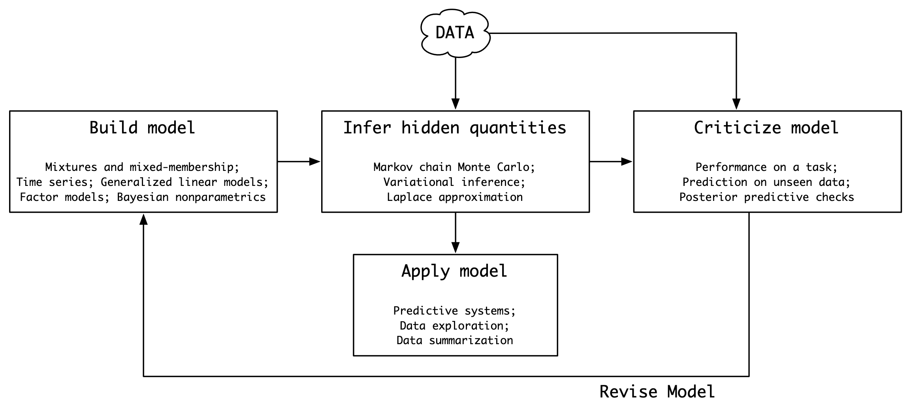
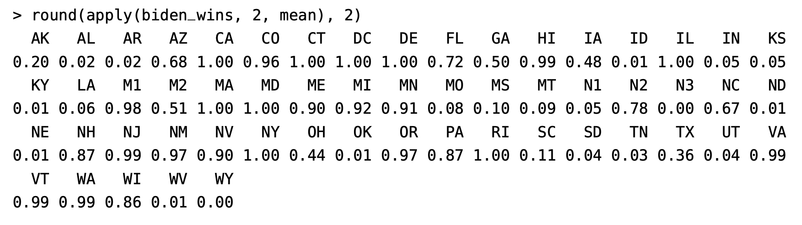
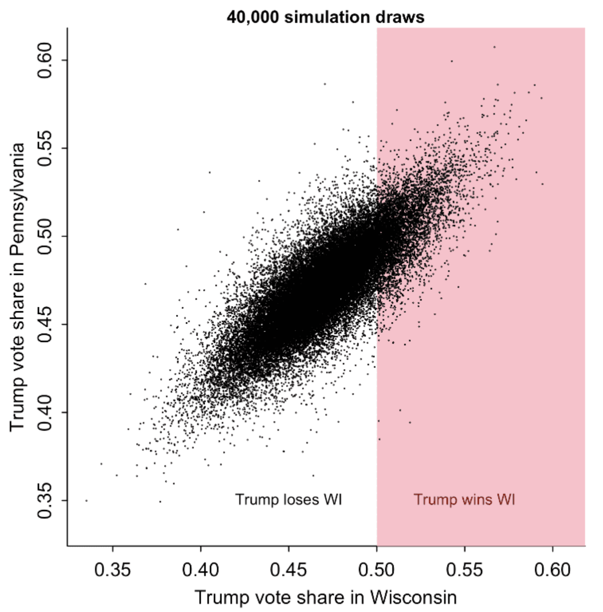

[Reading](https://ema.drwhy.ai/partialDependenceProfiles.html)
[Code]()

```{r}
#| label: setup
#| echo: false
library(knitr)
library(tidyverse)
library(caret)
library(tidyverse)
library(DALEX)
library(brms)
theme_set(theme_classic())
set.seed(2026)
```

1. When we read data analysis reports or attend statistical research seminar, we
are bound to be bombarded by numerical outputs from models, $p$-values, test set
accuracies, parameter estimates, $R^2$ values... This is all helpful for keeping
everyone honest about how good models really are, but if we want to build
intuition (and improve) models, then it really helps to visualize them.

1. In fact, we can integrate visualization throughout the model building
process. In data science, there is a cliche that visualization is mainly useful
at the very beginning (exploratory data analysis) or end (pretty presentations)
of a study. But careful modeling requires visualization at all steps.

1. UW-Madison's Statistics Department was founded by George Box, one of the most
important statisticians of the 20th century. Among many methdological
contributions, he is famous for the quote, "All models are wrong, but some are
useful." I've always found it a bit unfortunate that this quote became so
popular without the related idea, "Box's Loop," becoming similarly famous. The
idea of the Loop is that we should seek out limitations in our models ("all
models are wrong") but then use that to suggest improvements.

{width=70%}

1. If this seems a little abstract, consider this example from the reading. The
538 blog releases election forecasts based on statistical models trained on
polling and historical election data. We'll consider a model they built just
before the 2020 US Presidential Election between Joe Biden and Donald Trump.
This supports simulation, so we can generate hypothetical election results using
the fitted model parameters. For each of the simulated datasets, we get a
percentage breakdown Biden vs. Trump for each state.

1. If we average the statewise results across all the simulated elections, then
the model makes sense, considering voting patterns in recent elections. For
example, California reliably votes for the Democrat (Biden) while Wyoming
reliably votes for the Republican (Trump).

{width=90%}

1. Further, for particular pairs of states, the correlations match our
expectations. For example, Wisconsin and Pennsylvania are traditionally "swing"
states, which have gone to either Democrats or Republicans in recent elections.
If we plot the simulated outcomes against one another, then they are positively
correlated, which is what we would expect if there were events (in the time
between the forecast and the final election) that either improved or damaged
their chances consistently across both states.

{width=60%}

1. But for other pairs, the results are suspicious. For example, the simulations
suggest that the outcomes in Washington (a Democrat-leaning state) and
Mississippi (a Republican-leaning state) are negative correlated. This is
strange, because it means that if Trump won Washington, he would be more likely
to _lose_ Mississippi. You would think that if he had won a historic upset and
succeeded in Washington, then surely he would have also won in Mississippi.

{width=60%}

1. The authors of our reading argue that this negative correlation is a
technical artifact of teh statistical model used by the 538 team, and not a real
pattern from any historical data. It turns out that the default statistical
choice the team used is not really compatible with our knowledge about the
problem setting. This is a place where defaults could be adapted to obtain a
more realistic model; i.e., it motivates moving through an interation of Box's
loop.

## Probabilistic Models

1. The election example is

3. As our running example, we will use a PM2.5 monitoring dataset. PM2.5 is a
type of air pollution that can be bad for public health. High-quality weather
station data apply in the areas around the weather station, but don't give any
information about what happens in the areas between stations. In contrast,
satellite data give global coverage, but they are lower quality.  In the last
decade, it's become popular to train models that use high quality station
measurements to adjust satellite data, which gets us closer to the best of both
worlds.

   ```{r}
   #| label: pm25-data
   f <- tempfile()
   download.file("https://github.com/jgabry/bayes-vis-paper/blob/master/bayes-vis.RData?raw=true", f)
   GM <- get(load(f))
   GM@data <- GM@data |>
       mutate(
           log_pm25 = log(pm25),
           log_sat = log(sat_2014)
       )
   ```

4. The baseline model uses the equation $\text{station} = a + b \times
\text{satellite}$ at co-located measurement points. The Global Burden of
Disease project employed this approach through 2016.

   ```{r}
   #| label: pm25-baseline
   ggplot(GM@data, aes(log_sat, log_pm25)) +
       geom_point(aes(col = super_region_name), size = 0.8, alpha = 0.7) +
       scale_color_brewer(palette = "Set2") +
       labs(x = "log(satellite)", y = "log(ground station)", col = "WHO Region") +
       coord_fixed()
   ```

5. Plotting reveals substantial heterogeneity and large residuals. The key
question: What factors correlate with residuals that could enhance model
performance?

   * Error terms $\epsilon_i$ in equations $y_i = f(x_i) + \epsilon_i$ represent
   unmeasured factors determining $x$-$y$ relationships.
   * Desert sand increases PM2.5 but remains invisible to satellites; residuals
   likely correlate with desert locations (PM2.5 underpredicted), suggesting
   inclusion of geographic features improves fit.

6. One hypothesis: country region significance. Fitting separate regression
lines per WHO super-region reveals slope variation, suggesting models should
incorporate region-specific slopes.

   ```{r}
   #| label: pm25-regions
   ggplot(GM@data, aes(log_sat, log_pm25)) +
       geom_point(aes(col = super_region_name), size = 0.4, alpha = 0.7) +
       geom_smooth(aes(col = super_region_name), method = "lm", se = FALSE, size = 2) +
       scale_color_brewer(palette = "Set2") +
       labs(x = "log(satellite)", y = "log(ground station)", col = "WHO Region") +
       coord_fixed()
   ```

7. WHO categorizations are somewhat arbitrary. An alternative approach is to
cluster ground stations by PM2.5 level to create problem-specific regional
groupings.

   ```{r}
   #| label: pm25-clusters
   average <- GM@data |>
       group_by(iso3) |>
       summarise(pm25 = mean(pm25))

   clust <- dist(average$pm25) |>
       hclust() |>
       cutree(k = 6)

   GM@data$cluster_region <- as.character(clust[match(GM@data$iso3, average$iso3)])
   ggplot(GM@data, aes(log_sat, log_pm25)) +
       geom_point(aes(col = cluster_region), size = 0.4, alpha = 0.7) +
       geom_smooth(aes(col = cluster_region), method = "lm", se = FALSE, size = 2) +
       scale_color_brewer(palette = "Set2") +
       labs(x = "log(satellite)", y = "log(ground station)", col = "Cluster Region") +
       coord_fixed()
   ```

8. Which model should we actually use? In some of your other classes, you might
have used cross-validation / test set error. While this is useful (and
relatively automatic), it doesn't necessarily tell you how to improve the model.
An alternative which often brings more insight is to simulate from the model and
see which aspects of the real data it can (and cannot) capture.

[detour to simulation/bayesian modeling]

### Prior predictive distributions

10. The prior predictive distribution can be used to decide whether certain model
families are reasonable candidates for a problem, before formally incorporating
the evidence coming from the data.

11. The idea is that if we can write down a generative model, then we can
simulate different datasets with it, even before estimating the model
parameters. This is often the case in Bayesian models, where we can (a) sample
parameters from the prior, and (b) simulate data from the model with those
parameters.

12.  If the simulated datasets are plausible, then the overall model class is a
reasonable one. If they are not, then the model class should be modified. Either
the prior or the likelihood might need revision.

13. For example, in the example below, we simulate datasets using both a vague
and an informative prior. Vague priors are often recommended because they are
« more objective » in some sense. However, in this case, we see that the
simulated datasets are not even remotely plausible.

    ```{r}
    #| label: vague-prior
    # function to simulate from vague prior
    prior1 <- function(Nsim) {
        tau0 <- 1 / sqrt(rgamma(1, 1, rate = 100))
        tau1 <- 1 / sqrt(rgamma(1, 1, rate = 100))
        sigma <- 1 / sqrt(rgamma(1, 1, rate = 100))
        beta0i <- rnorm(7, 0, tau0)
        beta1i <- rnorm(7, 0, tau1)
        beta0 <- rnorm(1, 0, 100)
        beta1 <- rnorm(1, 0, 100)

        epsilon <- rnorm(Nsim, 0, sigma)
        data.frame(
            log_pm25 = GM$log_pm25,
            region = GM$super_region_name,
            sim = beta0 + beta0i[GM$super_region] + (beta1 + beta1i[GM$super_region]) * GM$log_sat + epsilon
        )
    }
    ```

    ```{r}
    #| label: vague-plot
    #| fig.cap: "Prior predictive samples from the vague prior are on a completely implausible scale."
    prior1_data <- map_dfr(1:12, ~ prior1(Nsim = nrow(GM@data)), .id = "replicate")
    ggplot(prior1_data, aes(x = log_pm25, y = sim)) +
        geom_abline(slope = 1) +
        geom_point(aes(col = region), alpha = 0.1, size = 0.4) +
        scale_color_brewer(palette = "Set2") +
        labs(x = "True station data", y = "Simulated station data") +
        facet_wrap(~replicate, scale = "free_y")
    ```

14. The block below instead simulates from a subjective, informative prior. The
resulting samples are much more plausible, lying in a comparable range to the
true data. However, note, the samples from the prior predictive do not need to
look exactly like the observed data — if they did, there would be no need to fit
model parameters! Instead, they should look like plausible datasets that might
have been observed.

    ```{r}
    #| label: informed-prior
    #| fig.cap: "Prior predictive samples from the weakly informative prior seem more plausible
    #| though they do not (and should not) exactly fit the true data."
    # function to simulate from informative prior
    prior2 <- function(Nsim) {
        tau0 <- abs(rnorm(1, 0, 1))
        tau1 <- abs(rnorm(1, 0, 1))
        sigma <- abs(rnorm(1, 0, 1))
        beta0i <- rnorm(7, 0, tau0)
        beta1i <- rnorm(7, 0, tau1)
        beta0 <- rnorm(1, 0, 1)
        beta1 <- rnorm(1, 1, 1)

        epsilon <- rnorm(Nsim, 0, sigma)
        data.frame(
            log_pm25 = GM$log_pm25,
            region = GM$super_region_name,
            sim = beta0 + beta0i[GM$super_region] + (beta1 + beta1i[GM$super_region]) * GM$log_sat + epsilon
        )
    }

    prior2_data <- map_dfr(1:12, ~ prior2(Nsim = nrow(GM@data)), .id = "replicate")
    ggplot(prior2_data, aes(x = log_pm25, y = sim)) +
        geom_abline(slope = 1) +
        geom_point(aes(col = region), alpha = 0.1, size = 0.4) +
        scale_color_brewer(palette = "Set2") +
        labs(x = "True station data", y = "Simulated station data") +
        facet_wrap(~replicate, scale = "free_y")
    ```

15. Philosophically, this prior predictive analysis is based on the idea that,
though probability is subjective, evidence can be used to update our beliefs.
The idea of the prior predictive is to visually encode subjective beliefs about
the problem under study before gathering new evidence.

### Posterior predictive distributions

16. Once the prior predictive is calibrated, we can fit the model. To evaluate
it’s quality, we can use the posterior predictive, which is just like the prior
predictive, except that it samples model parameters from the data-informed
posterior, rather than the data-ignorant prior. Roughly speaking, it is the
distribution of new datasets when drawing parameters from the fitted model.

19. The code below fits three models with the `brms` package. The first model
fits a linear model with random slope and intercept terms, but assumes the
effects are shared across the all countries. The next two variations
fit separate slopes and intercepts within each super-region
(`(1 + log_sat || super_region_name)`) and geographical
cluster (`(1 + log_sat || cluster_region)`). The way we read this is that the
term after `||` defines groups and the terms before it define parameters that
differ across those groups. The `log_sat` term is the effect associated with the
`log_sat` feature (slope in our scatterplots above) and `1` specifies the
intercept.

    We use the `prior()` block at the top to specify a plausible values for each of
    the model parameters. For example, the first line encodes our assumption that
    the overall log(PM2.5) level should be centered around 0. This has the effect of
    stabilizing the model fit around this value.

    ```{r}
    #| label: fit-models
    dir.create("fits", showWarnings = FALSE)
    priors_lm <- c(
        prior(normal(0, 1), class = "b", coef = "Intercept"),
        prior(normal(1, 1), class = "b", coef = "log_sat"),
        prior(normal(0, 1), class = "sigma")
    )
    priors_hier <- c(priors_lm, prior(normal(0, 1), class = "sd"))

    models <- list(
        "lm" = brm(
            log_pm25 ~ 0 + Intercept + log_sat,
            data = GM@data, prior = priors_lm, chains = 1,
            file = "fits/pm25_lm"
        ),
        "regions" = brm(
            log_pm25 ~ 0 + Intercept + log_sat + (1 + log_sat || super_region_name),
            data = GM@data, prior = priors_hier, chains = 1,
            file = "fits/pm25_regions"
        ),
        "clusters" = brm(
            log_pm25 ~ 0 + Intercept + log_sat + (1 + log_sat || cluster_region),
            data = GM@data, prior = priors_hier, chains = 1,
            file = "fits/pm25_clusters"
        )
    )
    ```

20. The code above takes a bit of time, about 10 minutes. Afterwards, it gets
saved to the `fits` directory. To simulate new PM2.5 data from the fitted
models, we can call `posterior_predict()` on them. This is done in the block
below simulates.  Note that, compared to the prior predictive, the posterior
predictive is much more closely related to the underlying dataset, which makes
sense, because it has been trained to approximate it.

    ```{r}
    #| label: post-plot
    #| fig-width: 10
    #| fig-height: 6
    #| fig.cap: "Samples from the posterior predictive in the cluster-based model."
    # extract 12 samples and reshape it to "long" format
    posterior_samples <- posterior_predict(models$clusters, ndraws = 12) |>
        t() |>
        as_tibble() |>
        bind_cols(GM@data) |>
        pivot_longer(V1:V12, names_to = "replicate", values_to = "log_pm25_sim")

    ggplot(posterior_samples, aes(log_pm25, log_pm25_sim)) +
        geom_abline(slope = 1) +
        geom_point(aes(col = cluster_region), size = 0.4, alpha = 0.1) +
        scale_color_brewer(palette = "Set2") +
        labs(x = "True station data", y = "Simulated station data") +
        facet_wrap(~replicate, scale = "free_y")
    ```

21. We can verify that features of the real dataset are accurately captured by
features of the posterior predictive. One subtlety is that there is a danger of
overfitting features in the posterior predictive. It is best to choose features
of the data that are not directly modeled (e.g., if you use slope in the model
estimation, then don’t evaluate the posterior predictive using the slope, since
by definition this will be well-captured). In the block below, we compute the
skewness for each simulated station dataset from the three different models.
These skewnesses are plotted as histograms, with the true dataset's skewness
indicated by a vertical line. It seems that the model that uses clustering to
define regions is able to simulate datasets with skewness similar to that in the
real dataset.

    ```{r}
    #| label: skewness
    #| fig-height: 3
    #| fig-width: 10
    #| fig.cap: "Posterior simulated skewness according to the three different models."
    apply_stat <- function(x, f) {
        z <- posterior_predict(x)
        tibble(
            "replicate" = seq_len(nrow(z)),
            "statistic" = apply(z, 1, f)
        )
    }

    skew <- function(x) {
        xdev <- x - mean(x)
        n <- length(x)
        r <- sum(xdev^3) / sum(xdev^2)^1.5
        r * sqrt(n) * (1 - 1 / n)^1.5
    }

    posteriors <- map_dfr(models, ~ apply_stat(., skew), .id = "model")
    truth <- skew(GM@data$log_pm25)
    ggplot(posteriors, aes(statistic)) +
        geom_histogram(aes(fill = model), binwidth = 0.01) +
        geom_vline(xintercept = truth, col = "red") +
        scale_fill_brewer(palette = "Set3")
    ```

## Explaining Black Boxes

22. Partial dependence profiles (PDP) and individual conditional expectation
(ICE) plots are explainability methods that can be applied post-hoc to any
model. They attempt to explain how the model relates a predictor variable/set of
predictor variables with the response.

23. Partial dependence profiles were first introduced as a minor point in an
influential paper about gradient boosting. ICE and ALE were introduced to
address some limitations of PDP, mainly related to the fact that prediction
surfaces can become complicated in high-dimensions and when many interactions
are present.

24. Let $f$ be the learned black box function. Let $x$ be its $D$-dimensional
input. The idea is to ask how $f$ changes as we vary the $d$th coordinate over
its range. We need to do something with the remaining coordinates; the idea of
PDP is to average across them.

    $$
    \text{PDP}_d(z) = \mathbb{E}_{p(x_{-d})}\left[f(x_d = z, x_{-d})\right] \approx \frac{1}{N}\sum_{n=1}^N f(x_d = z, x_{n, -d})
    $$

    The highlighted part refers to manually intervening on the $d$th coordinate and
    setting it to $z$. If we evaluate this average across many different values of
    $z$, we get a PDP curve. Note that for each value $z$, we compute an average
    across the entire dataset -- this can get slow.

25. This definition generalizes to larger-dimensional subsets of variables, but
we'll stick to one-dimensional curves for simplicity.

26. Here is some geometric intuition. We take the original samples, manually set
all their $d$th coordinates to $z$, evaluate the function $f$, and then
average. We repeat this for many $z$'s to trace out the partial dependence
curve.

    

## Individual Conditional Expectations

27. ICE plots consider each term in the PDP formula as its own function of $z$.

    $$
    h_n(z) := f(x_d = z, x_{n, -d})
    $$

    This has the nice "Ceteris Paribus" interpretation. For each sample, it traces
    out the curve where the $d$th coordinate is set to different values $z$ but all
    other coordinates are held fixed.

28. The key insight is that these curves can be meaningful on their own. The
averaging step in PDP can mask some meaningful variation in model predictions.
This is especially useful for discovering interactions. For example, here are
ICE curves for a model trained to predict survival with the Titanic dataset.
The age effect is very different for crew vs. passengers.

    

29. Two common tricks for ICE plots:

    * We might suspect an interaction with an unmeasured variable. This can
    sometimes be seen as groups of curves with different shapes, but where we
    don't have a variable in the data that splits those groups. In this case,
    people often cluster the curves and use cluster membership as a stand in for
    the unobserved interacting variable.

    

    * Often the curves are offset because of differences in the coordinates other
    than the $d$th. To see whether they nonetheless have similar shapes, it's
    sometimes helpful to "center" the curves, so that they all start out equal to
    one another.

    $$
    \tilde{h}_n(z) = f(x_d = z, x_{n, -d}) - f(x_d = 0, x_{n, -d})
    $$

    

30. Partial dependence (PD) plots help answer the question, « How is feature $j$
used by my model $f$? » Slight variations on PD plots are useful for some
related followup questions,
  	* Has my model $f$ learned interactions between features $j$ and $j^{\prime}$?
  	* How do the models $f$ and $f^{\prime}$ differ in the way that they use feature $j$?

31. The variants, called Grouped and Contrastive PD plots, reduce the original CP
profiles less aggressively than PD plots, but without becoming overwhelmingly
complicated.

### Interactions

32. We say that there is an interaction between variables $j$ and $j^{\prime}$ if
the relationship between $x_{j}$ and $y$ is modulated by variable $j^{\prime}$.
For example, in the figure below, the slope of cross-sections across $j$ depends
on $j^{\prime}$.

33. Using the language of CP profiles, the figure above means that the shape of
the CP profile in $j$ depends on the particular setting of $j^{\prime}$. This
motivates the use of Grouped PD profiles — we compute several PD profiles in
$j$, restricting attention to CP profiles whose value $x_{j^{\prime}}$ lies
within a prespecified range.

34. To illustrate, we revisit the CP profiles for age from the Titanic dataset.
Below, the profiles are grouped according to the class of the ticket holder. The
result shows that the relationship between age and survival was not the same
across all passengers. For all classes, there was a decrease in survival
probability for adults, but the dropoff was most severe for crew members.

    ```{r}
    #| label: titanic-cp
    #| fig.cap: "Grouping the CP profiles by ticket class reveals an interaction effect with age in the Titanic dataset."
    f <- tempfile()
    download.file("https://uwmadison.box.com/shared/static/nau695mppsoxx0f6bns1ieo7kh1bje0j.rda", f)
    fit <- get(load(f))

    data(titanic)
    titanic <- titanic |>
        select(-country) |>
        na.omit()
    x <- select(titanic, -survived)

    explanation <- explain(model = fit, data = x, y = titanic$survived)
    profiles <- model_profile(explainer = explanation, groups = "class")
    plot(profiles, geom = "profiles", variables = "age") +
        scale_color_brewer(palette = "Set2")
    ```

35. What should we do if there are many input variables and we don’t have a
priori knowledge about which variables $j^{\prime}$ might be interacting with
$j$? One idea is to try to *discover* relevant interactions by clustering the
original set of CP profiles.

36. In more detail, we can compute the CP profiles for all the samples, and then
see whether there are subsets of profiles that all look similar. If we find
features $j^{\prime}$ that characterize these groupings, then we have found
features that interact with $j$ (with respect to the fitted model $f$). The plot
below shows the same profiles as above, but clustering directly. It seems to
recover the interaction between age and class, even though we have not
explicitly provided this grouping variable.

    ```{r}
    #| label: titanic-clusters
    #| fig.cap: "Discovered groupings in the CP profiles for age reveals an interaction effect."
    profiles <- model_profile(explainer = explanation, variables = "age", k = 3)
    plot(profiles, geom = "profiles", variables = "age") +
        scale_color_brewer(palette = "Set2")
    ```

### Model Comparison

37. The comparison of different models’ PD profiles can be used to,
  	* Validate a simple model
  	* Guide the design of new features, and
  	* Characterizing overfitting
  	PD profiles that are used to compare different models are sometimes called
  	« Contrastive » PD profiles.

38. To validate a simple model, we can compare its PD profiles with those of a
more sophisticated model. We will illustrate this by fitting linear and random
forest models to a dataset of apartment prices^[It is a simulated dataset, but
designed to reflect properties of a real dataset.]. Given various properties of
an apartment, the goal is to determine its price. The code below fits the two
models and extracts their CP and PD profiles.

    ```{r}
    #| label: apartments-fit
    data(apartments)
    x <- select(apartments, -m2.price)
    profiles_lm <- train(x, apartments$m2.price, method = "lm") |>
        explain(x, apartments$m2.price, label = "LM") |>
        model_profile()
    profiles_rf <- train(x, apartments$m2.price, method = "rf", tuneGrid = data.frame(mtry = 10)) |>
        explain(x, apartments$m2.price, label = "RF") |>
        model_profile()
    ```

39. The PD profile below shows that the random forest learns linear
relationships with price for both the surface and floor variables. If all the
effects were like this, then we would have a good reason for preferring the
linear model.

    ```{r}
    #| label: pd-linear
    #| fig.cap: "A contrastive PD display suggests that the floor and surface features are linearly related with apartment price."
    plot(profiles_lm, profiles_rf, variables = c("surface", "floor")) +
        scale_color_brewer(palette = "Set2")
    ```

40. When making the comparison between a simple and a complex model, certain
discrepancies might become apparent. For example, important nonlinearities or
interactions might be visible from the PD profiles of the complex model. This
information can guide the design of new features in the simpler model, so that
it can continue to be used. This is exactly the case in the apartments dataset
above -- there is a strong nonlinear relationship for the construction year
variables. This suggests that, if a linear model is still desired, then a new
feature should be defined that identifies whether the apartment was built
between 1935 and 1990.

    ```{r}
    #| label: pd-nonlinear
    #| fig.cap: "The random forest learns a nonlinear relationship between construction year and apartment price. This suggests designing new features to include in the linear model."
    plot(profiles_lm, profiles_rf, variables = "construction.year") +
        scale_color_brewer(palette = "Set2")
    ```

41. Suppose you have found that a model is overfitting (e.g., by finding that
it’s training error is much lower than its test error). One way to address this
overfitting is to compare the PD profiles between the simple and complex models.
If the profiles are very different for one of the features, then that feature
may be the source of overfitting.


    <!-- styler::style_file("11-predictions.qmd", indent_by = 4) -->