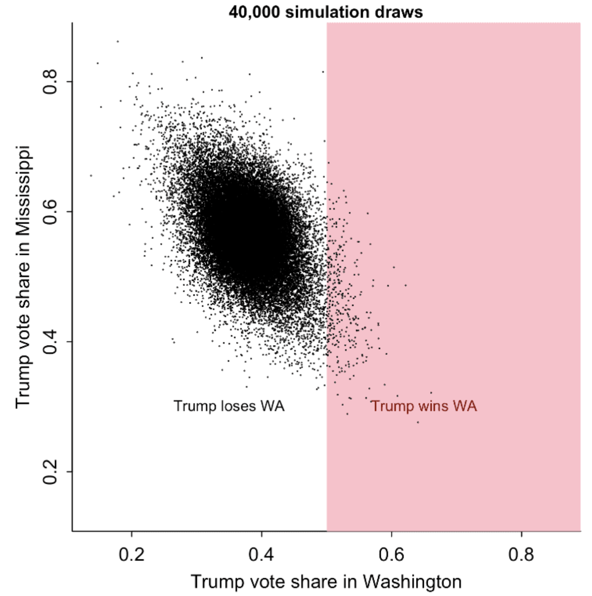

[Reading](https://ema.drwhy.ai/partialDependenceProfiles.html)
[Code]()

```{r}
#| label: setup
#| echo: false
library(knitr)
library(tidyverse)
library(caret)
library(tidyverse)
library(DALEX)
library(brms)
library(bayesplot)
library(patchwork)
theme_set(theme_classic())
set.seed(2026)
```

1. When we read data analysis reports or attend statistical research seminar, we
are bound to be bombarded by numerical outputs from models, $p$-values, test set
accuracies, parameter estimates, $R^2$ values... This is all helpful for keeping
everyone honest about how good models really are, but if we want to build
intuition (and improve) models, then it really helps to visualize them.

2. In fact, we can integrate visualization throughout the model building
process. In data science, there is a cliche that visualization is mainly useful
at the very beginning (exploratory data analysis) or end (pretty presentations)
of a study. But careful modeling requires visualization at all steps.

3. UW-Madison's Statistics Department was founded by George Box, one of the most
important statisticians of the 20th century. Among many methdological
contributions, he is famous for the quote, "All models are wrong, but some are
useful." I've always found it a bit unfortunate that this quote became so
popular without the related idea, "Box's Loop," becoming similarly famous. The
idea of the Loop is that we should seek out limitations in our models ("all
models are wrong") but then use that to suggest improvements.

   {width=70%}

4. If this seems a little abstract, consider this example from the reading. The
538 blog releases election forecasts based on statistical models trained on
polling and historical election data. We'll consider a model they built just
before the 2020 US Presidential Election between Joe Biden and Donald Trump.
This supports simulation, so we can generate hypothetical election results using
the fitted model parameters. For each of the simulated datasets, we get a
percentage breakdown Biden vs. Trump for each state.

5. If we average the statewise results across all the simulated elections, then
the model makes sense, considering voting patterns in recent elections. For
example, California reliably votes for the Democrat (Biden) while Wyoming
reliably votes for the Republican (Trump).

   {width=90%}

6. Further, for particular pairs of states, the correlations match our
expectations. For example, Wisconsin and Pennsylvania are traditionally "swing"
states, which have gone to either Democrats or Republicans in recent elections.
If we plot the simulated outcomes against one another, then they are positively
correlated, which is what we would expect if there were events (in the time
between the forecast and the final election) that either improved or damaged
their chances consistently across both states.

   {width=60%}

7. But for other pairs, the results are suspicious. For example, the simulations
suggest that the outcomes in Washington (a Democrat-leaning state) and
Mississippi (a Republican-leaning state) are negative correlated. This is
strange, because it means that if Trump won Washington, he would be more likely
to _lose_ Mississippi. You would think that if he had won a historic upset and
succeeded in Washington, then surely he would have also won in Mississippi.

   {width=60%}

8. The authors of our reading argue that this negative correlation is a
technical artifact of teh statistical model used by the 538 team, and not a real
pattern from any historical data. It turns out that the default statistical
choice the team used is not really compatible with our knowledge about the
problem setting. This is a place where defaults could be adapted to obtain a
more realistic model; i.e., it motivates moving through an interation of Box's
loop.

## Probabilistic Models

### Notation

9. If the election example feels a bit ad hoc to you, then you have a good
instinct for statistics. One of the goals of statistical methods research is to
formalize good intuition using more mathematical language, and that's exactly
what we'll do here.  In this way, we'll ensure that good ideas that appear in
one specific field can be easily adapted to other fields.

10. We will use the following notation. A simulation model is one that allows us
to draw replicate datasets $y_{i}^{\text{rep}}$ given an observed dataset $y$,
$$
y_{1}^{\text{rep}}, \dots, y_{n}^{\text{rep}} \sim p\left(y^{\text{rep}} \vert y\right).
$$
 You should think of each
$y_{i}^{\text{rep}}$ and $y$ as vectors, because they represent an entire
dataset.

    - In our reading, the probability on the right hand side is called the
    **posterior predictive distribution**. The hope is that after having observed the real dataset $y$, the
    distribution $p\left(y^{\text{rep}} \vert y\right)$ should allow us to simulate
    new replicates that look similar to the real data.

    - In contrast, the
    **prior predictive distribution**, denoted $p\left(y^{\text{rep}}\right)$, describes how we would simulate new datasets
    $y^{\text{rep}}$ before having observed any real data $y$.

### Running Example

11. As our running example, we will use a PM2.5 monitoring dataset. PM2.5 is a
type of air pollution that can be bad for public health. High-quality weather
station data apply in the areas around the weather station, but don't give any
information about what happens in the areas between stations. In contrast,
satellite data give global coverage, but they are lower quality.  In the last
decade, it's become popular to train models that use high quality station
measurements to adjust satellite data, which gets us closer to the best of both
worlds. If it works well, it could be used to monitor PM2.5 levels at global
scale.

    ```{r}
    #| label: pm25-data
    f <- tempfile()
    download.file("https://github.com/jgabry/bayes-vis-paper/blob/master/bayes-vis.RData?raw=true", f)
    GM <- get(load(f))
    GM@data <- GM@data |>
        mutate(
            log_pm25 = log(pm25),
            log_sat = log(sat_2014)
        )
    ```

12. The simplest model simply fits
$\text{station} = a + b \times \text{satellite}$  at locations where they are
both available. This model was used in practice by the Global Burden of Disease
project until 2016.

    ```{r}
    #| label: pm25-baseline
    ggplot(GM@data, aes(log_sat, log_pm25)) +
        geom_point(size = 0.8, alpha = 0.7) +
        labs(x = "log(satellite)", y = "log(ground station)", col = "WHO Region") +
        coord_fixed()
    ```

13. When we plot these two variables against one another, we can see that we
won't be able to obtain good predictions for the station measurements using the
satellite data alone.  What features might we include to improve the model fit?

14. One hypothesis is that country region is an important factor. Below, we fit
regression lines separately for different country super-regions, as specified by
the WHO. The fact that the slopes are not the same in each region means that we
should modify our model to have a different slope in each region 1 .
   ```{r}
   #| label: pm25-regions
   ggplot(GM@data, aes(log_sat, log_pm25)) +
       geom_point(aes(col = super_region_name), size = 0.4, alpha = 0.7) +
       geom_smooth(aes(col = super_region_name), method = "lm", se = FALSE, size = 2) +
       scale_color_brewer(palette = "Set2") +
       labs(x = "log(satellite)", y = "log(ground station)", col = "WHO Region") +
       coord_fixed()
   ```

15. The WHO categorizations are somewhat arbitrary. Maybe there are better
country groupings, tailored specifically to the PM2.5 problem? One idea is to
cluster the ground stations based on PM2.5 level and use these clusters as a
different region grouping.

    ```{r}
    #| label: pm25-clusters
    average <- GM@data |>
        group_by(iso3) |>
        summarise(pm25 = mean(pm25))

    clust <- dist(average$pm25) |>
        hclust() |>
        cutree(k = 6)

    GM@data$cluster_region <- as.character(clust[match(GM@data$iso3, average$iso3)])
    ggplot(GM@data, aes(log_sat, log_pm25)) +
        geom_point(aes(col = cluster_region), size = 0.4, alpha = 0.7) +
        geom_smooth(aes(col = cluster_region), method = "lm", se = FALSE, size = 2) +
        scale_color_brewer(palette = "Set2") +
        labs(x = "log(satellite)", y = "log(ground station)", col = "Cluster Region") +
        coord_fixed()
    ```

16. Which model should we actually use? In some of your other classes, you might
have used cross-validation / test set error. While this is useful (and
relatively automatic), it doesn't necessarily tell you how to improve the model.
An alternative which often brings more insight is to simulate from the model and
see which aspects of the real data it can (and cannot) capture.

### Prior predictive distributions

17. The prior predictive distribution can be used to decide whether certain model
families are reasonable candidates for a problem, before fitting the models to
actual data.  If the simulated datasets are plausible, then the overall model
class is a reasonable one. If they are not, then the model class should be
modified. Either the prior or the likelihood might need revision.

18. For example, in the example below, we simulate datasets two types of model
assumptions, based on "vague" and "informative" priors, respectively. The first
type of assumption is quite common in practice, and a version of this is likely
what the 538 team used. However, in the PM2.5 example, the simulated data using
the vague prior is not even remotely plausible.

    ```{r}
    #| label: vague-prior
    # function to simulate from vague prior
    prior1 <- function(Nsim) {
        tau0 <- 1 / sqrt(rgamma(1, 1, rate = 100))
        tau1 <- 1 / sqrt(rgamma(1, 1, rate = 100))
        sigma <- 1 / sqrt(rgamma(1, 1, rate = 100))
        beta0i <- rnorm(7, 0, tau0)
        beta1i <- rnorm(7, 0, tau1)
        beta0 <- rnorm(1, 0, 100)
        beta1 <- rnorm(1, 0, 100)

        epsilon <- rnorm(Nsim, 0, sigma)
        data.frame(
            log_pm25 = GM$log_pm25,
            region = GM$super_region_name,
            sim = beta0 + beta0i[GM$super_region] + (beta1 + beta1i[GM$super_region]) * GM$log_sat + epsilon
        )
    }
    ```

    ```{r}
    #| label: vague-plot
    #| fig.cap: "Prior predictive samples from the vague prior are on a completely implausible scale."
    prior1_data <- replicate(12, prior1(Nsim = nrow(GM@data))$sim) |>
        t()
    ppc_scatter(
        y = GM$log_pm25,
        yrep = prior1_data,
        size = 0.4,
        alpha = 0.1,
        facet_args = list(scales = "free_x", ncol = 4)
    ) +
        labs(x = "Simulated station data", y = "True station data")
    ```

19. The block below instead simulates from a subjective, informative prior. The
resulting samples are much more plausible, lying in a comparable range to the
true data. However, note that the samples from the prior predictive do not need
to look exactly like the observed data. If they did, then we wouldn't have to
collect real data at all! All we ask is that they are roughly compatible with
our prior knowledge of the problem setting.

    ```{r}
    #| label: informed-prior
    #| fig.cap: "Prior predictive samples from the weakly informative prior seem more plausible
    #| though they do not (and should not) exactly fit the true data."
    # function to simulate from informative prior
    prior2 <- function(Nsim) {
        tau0 <- abs(rnorm(1, 0, 1))
        tau1 <- abs(rnorm(1, 0, 1))
        sigma <- abs(rnorm(1, 0, 1))
        beta0i <- rnorm(7, 0, tau0)
        beta1i <- rnorm(7, 0, tau1)
        beta0 <- rnorm(1, 0, 1)
        beta1 <- rnorm(1, 1, 1)

        epsilon <- rnorm(Nsim, 0, sigma)
        data.frame(
            log_pm25 = GM$log_pm25,
            region = GM$super_region_name,
            sim = beta0 + beta0i[GM$super_region] + (beta1 + beta1i[GM$super_region]) * GM$log_sat + epsilon
        )
    }

    prior2_data <- replicate(12, prior2(Nsim = nrow(GM@data))$sim) |>
        t()
    ppc_scatter(
        y = GM$log_pm25,
        yrep = prior2_data,
        size = 0.4,
        alpha = 0.1,
        facet_args = list(scales = "free_x", ncol = 4)
    ) +
        labs(x = "Simulated station data", y = "True station data")
    ```

### Posterior predictive distributions

20. Once the prior predictive is calibrated, we can fit the model. To evaluate
its quality, we can use the posterior predictive, which is just like the prior
predictive, except that it samples model parameters after having fit the model
to the data.

21. The code below fits three models with the `brms` package^[In any HW or exam questions, we will give you `brms` code. You don't need to know how to run the models, just how to visualize the simulated samples.]. The first model
fits a linear model with random slope and intercept terms, but assumes the
effects are shared across the all countries. The next two variations
fit separate slopes and intercepts within each super-region
(`(1 + log_sat || super_region_name)`) and geographical
cluster (`(1 + log_sat || cluster_region)`). The way we read this is that the
term after `||` defines groups and the terms before it define parameters that
differ across those groups. The `log_sat` term is the effect associated with the
`log_sat` feature (slope in our scatterplots above) and `1` specifies the
intercept.

    We use the `prior()` block at the top to specify a plausible values for each of
    the model parameters. For example, the first line encodes our assumption that
    the overall log(PM2.5) level should be centered around 0. This has the effect of
    stabilizing the model fit around this value.

    ```{r}
    #| label: fit-models
    dir.create("fits", showWarnings = FALSE)
    priors_lm <- c(
        prior(normal(0, 1), class = "b", coef = "Intercept"),
        prior(normal(1, 1), class = "b", coef = "log_sat"),
        prior(normal(0, 1), class = "sigma")
    )
    priors_hier <- c(priors_lm, prior(normal(0, 1), class = "sd"))

    models <- list(
        "lm" = brm(
            log_pm25 ~ 0 + Intercept + log_sat,
            data = GM@data, prior = priors_lm, chains = 1,
            file = "fits/pm25_lm"
        ),
        "regions" = brm(
            log_pm25 ~ 0 + Intercept + log_sat + (1 + log_sat || super_region_name),
            data = GM@data, prior = priors_hier, chains = 1,
            file = "fits/pm25_regions"
        ),
        "clusters" = brm(
            log_pm25 ~ 0 + Intercept + log_sat + (1 + log_sat || cluster_region),
            data = GM@data, prior = priors_hier, chains = 1,
            file = "fits/pm25_clusters"
        )
    )
    ```

22. The code above takes a bit of time, about 10 minutes. Afterwards, it gets
saved to the `fits` directory. To simulate new PM2.5 data from the fitted
models, we can call `posterior_predict()` on them. This is done in the block
below simulates.  Note that, compared to the prior predictive, the posterior
predictive is much more closely related to the underlying dataset, which makes
sense, because it has been trained to approximate it.

    ```{r}
    #| label: post-plot
    #| fig-width: 10
    #| fig-height: 6
    #| fig.cap: "Samples from the posterior predictive in the cluster-based model."
    pp_check(
        models$clusters,
        type = "scatter",
        ndraws = 12,
        size = 0.4,
        alpha = 0.1,
        facet_args = list(scales = "free_x", ncol = 4)
    ) +
        labs(x = "Simulated station data", y = "True station data")
    ```

23. We can next define **test summaries** to see whether properties of the real
data are captured by the posterior predictive distribution.  In the block below,
we compute the skewness for each simulated station dataset from the three
different models.  These skewnesses are plotted as histograms, with the true
dataset's skewness indicated by a vertical line. It seems that the model that
uses clustering to define regions is able to simulate datasets with skewness
similar to that in the real dataset.

    ```{r}
    #| label: skewness
    #| fig-height: 3
    #| fig-width: 10
    #| fig.cap: "Posterior simulated skewness according to the three different models."
    skew <- function(x) {
        xdev <- x - mean(x)
        n <- length(x)
        r <- sum(xdev^3) / sum(xdev^2)^1.5
        r * sqrt(n) * (1 - 1 / n)^1.5
    }

    plots <- imap(models, ~
        pp_check(.x, type = "stat", stat = skew, binwidth = 0.01) +
            ggtitle(.y)
    )
    wrap_plots(plots, nrow = 1)
    ```

24. According to this summary, it seems like the `regions` model is the best. It
gives simulated datasets whose skewness values match those that we observed in
the real data. Of course, someone could call into our question the choice of
using skewness over other test statistics. But we can at least have a productive
debate by suggesting and evaluating different test statistics.

25. So far, we've worked with models that directly support simulation. This is
actually a relatively broad class. It includes the Bayesian models discussed in
the reading, of course, but also the humble linear model.

    ```{r}
    x <- seq(-1, 1, length.out = 10)
    y <- 2 * x + 0.1 * rnorm(10)
    fit <- lm(y ~ x)
    simulate(fit, nsim = 8)
    ```

    Perhaps surprisingly, it even includes advanced AI models, like image generation
    models and LLMs (which, after all, are just simulating text).

26. That said, not all models support simulation. For example, if we fit a random
forest model, we can ask for predictions at any test point $x$, but we can't ask
it to simulate new datasets. For the rest of this note, we're going to focus on
how we can use visualization to analyze these types of models, which let us
query test points for predictions but can't simulate.

## Explaining Black Boxes

27. Specifically, we'll focus on Partial dependence profiles (PDP) and
individual conditional expectation (ICE) plots. They are general-purpose
visualizations that attempt to explain how the model relates a predictor
variable/set of predictor variables with the response.

28. Partial dependence profiles were first introduced as a minor point in an
influential paper about gradient boosting [@friedman2001greedy]. ICE and ALE
were introduced to address some limitations of PDP, mainly related to the fact
that prediction surfaces can become complicated in high-dimensions and when many
interactions are present.

29. Let $f$ be the learned black box function. Let $x$ be its $D$-dimensional
input. The idea is to ask how $f$ changes as we vary the $d$th coordinate over
its range. We need to do something with the remaining coordinates. The idea of
PDP is to average across them.

    $$
    \text{PDP}_d(z) = \mathbb{E}_{p(x_{-d})}\left[f(x_d = z, x_{-d})\right] \approx \frac{1}{N}\sum_{n=1}^N f(x_d = z, x_{n, -d})
    $$

    The highlighted part refers to manually intervening on the $d^{th}$ coordinate and
    setting it to $z$. If we evaluate this average across many different values of
    $z$, we get a PDP curve. Note that for each value $z$, we compute an average
    across the entire dataset, which can get slow.

30. Here is some geometric intuition. We take the original samples, manually set
all their $d^{th}$ coordinates to $z$, evaluate the function $f$, and then
average.

    

    We repeat this for many $z$'s to trace out the partial dependence
    curve.

    

### Individual Conditional Expectations

31. ICE plots consider each term in the PDP formula as its own function of $z$.

    $$
    h_n(z) := f(x_d = z, x_{n, -d})
    $$

    This has the nice "Ceteris Paribus" interpretation. For each sample, it traces
    out the curve where the $d$th coordinate is set to different values $z$ but all
    other coordinates are held fixed.

32. The key insight is that these curves can be meaningful on their own. The
averaging step in PDP can mask some meaningful variation in model predictions.
This is especially useful for discovering interactions. For example, here are
ICE curves for a model trained to predict survival with the Titanic dataset.
The age effect is very different for crew vs. passengers.

    

### Example

33. Let's consider how ICE and PDP can be used to understand a model fitted to
the Titanic dataset. This is a dataset that was used to understand what
characteristics survivors of the Titanic disaster had in common.  It’s not
obvious in advance which characteristics of passengers made them more likely to
survive, so a model is fitted to predict survival.

    ```{r}
    data(titanic)
    titanic <- select(titanic, -country) |>
      na.omit()

    x <- select(titanic, -survived)
    hyper <- data.frame(n.trees = 100, interaction.depth = 8, shrinkage = 0.1, n.minobsinnode = 10)
    fit <- train(x = x, y = titanic$survived, method = "gbm", tuneGrid = hyper, verbose = F)
    ```

34. Next, we can compute the ICE curves using the `DALEX` package. We are showing
the relationship between age and survival, though any subset of variables could
be requested. The bold curve is a Partial Dependence (PD) profile. Each of the
other curves corresponds to a passenger, though only a subsample is shown. The
curves are obtained by fixing all the characteristics of the passanger except
for age, and then seeing what happens to the prediction when the age variable is
increased or decreased.

    ```{r}
    explanation <- explain(model = fit, data = x, y = titanic$survived)
    profile <- model_profile(explainer = explanation)
    plot(profile, geom = "profiles", variables = "age")
    ```

35. It seems that children had the highest probability 2 of survival. The
relationship is far from linear, with those between 40 and 60 all having about
the same probabilities. Notice that the profiles are vertically offset from one
passenger to another. This is because, aside from age, each passenger had
characteristics that made them more or less likely to survive.

36. Some details about the code. The `explain` function takes the fitted model
and original dataset as input. It returns an object with many kinds of model
summaries. To extract the ICE profiles from these summaries, we use
`model_profile`. The output of this function has been designed so that calling
plot with `geom = "profiles"` will show the ICE profiles.

### Interactions

37. We say that there is an interaction between variables $j$ and $j^{\prime}$ if
the relationship between $x_{j}$ and $y$ is modulated by variable $j^{\prime}$.
For example, in the figure below, the slope of cross-sections across $j$ depends
on $j^{\prime}$.

38. Using the language of partial dependence profiles, the figure above means that the shape of
the PDP profile in $j$ depends on the particular setting of $j^{\prime}$. This
motivates the use of Grouped PD profiles — we compute several PD profiles in
$j$, restricting attention to CP profiles whose value $x_{j^{\prime}}$ lies
within a prespecified range.

39. To illustrate, we revisit the CP profiles for age from the Titanic dataset.
Below, the profiles are grouped according to the class of the ticket holder. The
result shows that the relationship between age and survival was not the same
across all passengers. For all classes, there was a decrease in survival
probability for adults, but the dropoff was most severe for crew members.

    ```{r}
    #| label: titanic-cp
    #| fig.cap: "Grouping the CP profiles by ticket class reveals an interaction effect with age in the Titanic dataset."
    f <- tempfile()
    download.file("https://uwmadison.box.com/shared/static/nau695mppsoxx0f6bns1ieo7kh1bje0j.rda", f)
    fit <- get(load(f))

    data(titanic)
    titanic <- titanic |>
        select(-country) |>
        na.omit()
    x <- select(titanic, -survived)

    explanation <- explain(model = fit, data = x, y = titanic$survived)
    profiles <- model_profile(explainer = explanation, groups = "class")
    plot(profiles, geom = "profiles", variables = "age") +
        scale_color_brewer(palette = "Set2")
    ```

40. What should we do if there are many input variables and we don’t have a
priori knowledge about which variables $j^{\prime}$ might be interacting with
$j$? One idea is to try to *discover* relevant interactions by clustering the
original set of CP profiles.

41. In more detail, we can compute the CP profiles for all the samples, and then
see whether there are subsets of profiles that all look similar. If we find
features $j^{\prime}$ that characterize these groupings, then we have found
features that interact with $j$ (with respect to the fitted model $f$). The plot
below shows the same profiles as above, but clustering directly. It seems to
recover the interaction between age and class, even though we have not
explicitly provided this grouping variable.

    ```{r}
    #| label: titanic-clusters
    #| fig.cap: "Discovered groupings in the CP profiles for age reveals an interaction effect."
    profiles <- model_profile(explainer = explanation, variables = "age", k = 3)
    plot(profiles, geom = "profiles", variables = "age") +
        scale_color_brewer(palette = "Set2")
    ```

### Model Comparison

42. The comparison of different models’ PD profiles can be used to,
  	* Validate a simple model
  	* Guide the design of new features, and
  	* Characterizing overfitting
  	PD profiles that are used to compare different models are sometimes called
  	« Contrastive » PD profiles.

43. To validate a simple model, we can compare its PD profiles with those of a
more sophisticated model. We will illustrate this by fitting linear and random
forest models to a dataset of apartment prices^[It is a simulated dataset, but
designed to reflect properties of a real dataset.]. Given various properties of
an apartment, the goal is to determine its price. The code below fits the two
models and extracts their CP and PD profiles.

    ```{r}
    #| label: apartments-fit
    data(apartments)
    x <- select(apartments, -m2.price)
    profiles_lm <- train(x, apartments$m2.price, method = "lm") |>
        explain(x, apartments$m2.price, label = "LM") |>
        model_profile()
    profiles_rf <- train(x, apartments$m2.price, method = "rf", tuneGrid = data.frame(mtry = 10)) |>
        explain(x, apartments$m2.price, label = "RF") |>
        model_profile()
    ```

44. The PD profile below shows that the random forest learns linear
relationships with price for both the surface and floor variables. If all the
effects were like this, then we would have a good reason for preferring the
linear model.

    ```{r}
    #| label: pd-linear
    #| fig.cap: "A contrastive PD display suggests that the floor and surface features are linearly related with apartment price."
    plot(profiles_lm, profiles_rf, variables = c("surface", "floor")) +
        scale_color_brewer(palette = "Set2")
    ```

45. When making the comparison between a simple and a complex model, certain
discrepancies might become apparent. For example, important nonlinearities or
interactions might be visible from the PD profiles of the complex model. This
information can guide the design of new features in the simpler model, so that
it can continue to be used. This is exactly the case in the apartments dataset
above -- there is a strong nonlinear relationship for the construction year
variables. This suggests that, if a linear model is still desired, then a new
feature should be defined that identifies whether the apartment was built
between 1935 and 1990.

    ```{r}
    #| label: pd-nonlinear
    #| fig.cap: "The random forest learns a nonlinear relationship between construction year and apartment price. This suggests designing new features to include in the linear model."
    plot(profiles_lm, profiles_rf, variables = "construction.year") +
        scale_color_brewer(palette = "Set2")
    ```

46. Suppose you have found that a model is overfitting (e.g., by finding that
it’s training error is much lower than its test error). One way to address this
overfitting is to compare the PD profiles between the simple and complex models.
If the profiles are very different for one of the features, then that feature
may be the source of overfitting.


    <!-- styler::style_file("11-predictions.qmd", indent_by = 4) -->