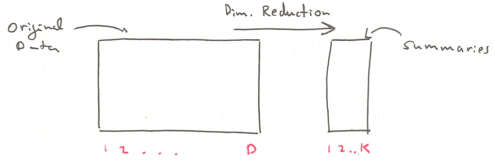
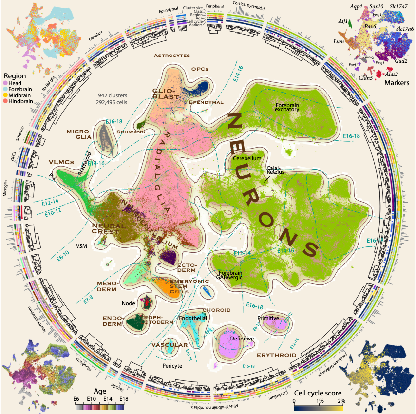
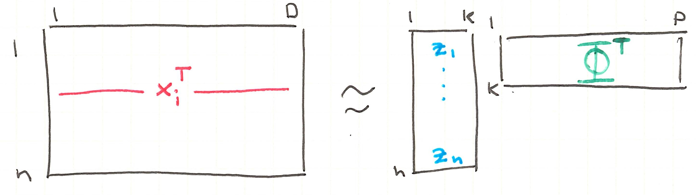
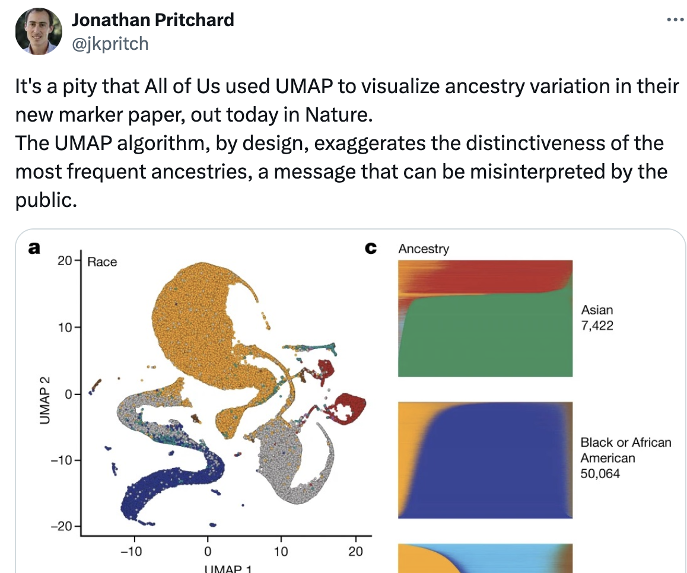

Reading [[1] (Section 10.2)](https://canvas.wisc.edu/courses/530541/files/54329609?wrap=1), [2 (optional)](https://visxai-dimensionality-reduction-1dbad0a67a092b007c526a45.vercel.app/), [3 (optional)](https://umap-learn.readthedocs.io/en/latest/how_umap_works.html)

[Code](https://github.com/krisrs1128/data_visualization_notes/blob/main/notes/11-predictions.qmd)

Items marked with $^\dagger$ will not be tested on exams.

```{r}
#| label: libraries
#| echo: false
library(ggrepel)
library(jsonlite)
library(knitr)
library(mlr3)
library(mlr3pipelines) # pak::pak(c("mlr-org/mlr3pipelines", "uwot"))
library(tidytext)
library(tidyverse)
theme479 <- theme_minimal() +
    theme(
        panel.grid.minor = element_blank(),
        panel.background = element_rect(fill = "#f7f7f7"),
        panel.border = element_rect(fill = NA, color = "#0c0c0c", size = 0.6),
        legend.position = "bottom"
    )
theme_set(theme479)
set.seed(479)
```

1. *High-dimensional data* are data with many features per sample. Often, the
number of features is comparable or larger than the number of samples, so when
the data are drawn as a rectangle with samples along rows and features along
columns, they are "wide."" The name comes from the fact that each row of the
dataset can be viewed as a vector in a high-dimensional space (one dimension for
each feature). These data are common in modern applications,

   * Each cell in a genomics dataset might have measurements for thousands of genes.
   * Each survey respondent might provide answers to dozens of questions.
   * Each image might have several thousand pixels.
   * Each document might have counts across several thousand relevant words.

   ```{r}
   #| label: high-dim-examples
   #| layout-ncol: 2
   #| fig-cap: "Examples of high-dimensional data."
   #| echo: false
   include_graphics(c(
       "figures/high-dim-genes.jpeg",
       "figures/high-dim-images.jpeg"
   ))
   ```


2. For low-dimensional data, we could visually encode all the features in our
data directly, either using visual channels or through small multiples. In
high-dimensional data, this is no longer possible. However, though there are
many features associated with each sample, it may still be possible to
organize samples across a smaller number of meaningful, derived features.

   ```{r}
   #| label: high-dim-summaries
   #| fig-cap: "Dimensionality reduction visualizations attempt to derive a smaller number of meaningful features."
   #| echo: false
   
   ```

3. For example, consider the Metropolitan Museum of Art dataset, which contains
images of many artworks. Abstractly, each artwork is a high-dimensional object,
containing pixel intensities across many pixels. But it is reasonable to derive
a feature based on the average brightness.

   ```{r}
   #| label: brightness
   #| echo: false
   #| fig.cap: "An arrangement of artworks according to their average pixel brightness
   #| as given in reading [2]."
   #| fig.align: "center"
   include_graphics("https://github.com/krisrs1128/stat436_s24/blob/main/exercises/figure/brightness.png?raw=true")
   ```

4. In general, manual feature construction can be difficult. Algorithmic
approaches streamline the process of generating these maps by optimizing
some more generic criterion. Different algorithms use different criteria, which
we will review below.

   ```{r}
   #| label: reduction-animation
   #| echo: false
   #| fig.cap: "The dimensionality reduction algorithm in this animation converts a large number of raw features into a position on a one-dimensional axis defined by average pixel brightness. In general
   #| we might reduce to dimensions other than 1D
   #| and we will often want to define features tailored to the dataset at hand."
   #| out.width: 400
   #| fig.align: "center"
   include_graphics("https://github.com/krisrs1128/stat436_s24/blob/main/exercises/figure/dimred-animation.gif?raw=true")
   ```

5. Informally, the goal of dimensionality reduction techniques is to produce a
low-dimensional "atlas" relating members of a collection of complex objects.
Samples that are similar to one another in the high-dimensional space should be
placed near one another in the low-dimensional view. For example, in the single
cell atlas below, each point represents a brain cell. In the original data, each
cell is associated with expression levels across thousands of genes. After
dimensionality reduction, cells with similar gene expression profiles get placed
into "islands" of comparable activity [@LaManno2020]. This gives a
quantitative/molecular way of categorizing different cell types, complementary
to the qualitative/morphological approach pioneered by early neuroscientists.

   ```{r}
   #| label: mouse-brain
   #| echo: false
   #| out.width: 900
   #| fig-cap: "An atlas of gene expression activity in single cell data, generated by [@LaManno2020]."
   
   ```

## Principal Components Analysis

### Definition

6. In the previous section, we saw how we could organize a collection of images
based on average pixel brightness. We can think of average pixel brightness as a
derived feature that can be used to build a low-dimensional map. We can
partially automate the process of deriving new features. In general, finding the
"best" derived features is an underspecified problem. To make progress, we can
restrict attention to,

   - Features that are linear combinations of the raw input columns.
   - Features that are orthogonal to one another.
   - Features that have high variance.

7. Restricting to *linear combinations* allows for an analytical solution. We
will relax this requirement when discussing UMAP. *Orthogonality* means that the
derived features will be uncorrelated with one another. This is a nice property,
because it would be wasteful if features were redundant. *High variance* is
desirable because it means we preserve more of the essential structure of the
underlying data. For example, if you look at this 2D representation of a 3D
object, it's hard to tell what it is,

   ```{r}
   #| label: pca-object
   #| echo: false
   #| fig.cap: "What is this object?"
   #| fig.align: "center"
   #| out.width: 60
   include_graphics("https://web.stanford.edu/class/bios221/imgs/CAM3.png")
   ```

   But when viewing an alternative reduction which has higher variance...

   ```{r}
   #| label: high-variance
   #| echo: false
   #| fig.cap: "Not so complicated now. Credit for this example goes to Professor Julie Josse
   #| at Ecole Polytechnique."
   #| fig.align: "center"
   #| out.width: 170
   include_graphics("https://web.stanford.edu/class/bios221/imgs/CAM4.png")
   ```

8. Principal Components Analysis (PCA) is the optimal dimensionality reduction
under these three restrictions, in the sense that it finds derived features with
the highest variance. Formally, PCA finds a matrix $\Phi \in \mathbb{R}^{D
\times K}$ and a set of vector $z_{i} \in \mathbb{R}^{K}$ such that $x_{i}
\approx \Phi z_{i}$ for all $i$. The columns of $\Phi$ are called principal
components, and they specify the structure of the derived linear features. The
vector $z_{i}$ is called the score of $x_{i}$ with respect to these components.
The top component explains the most variance, the second captures the next most,
and so on.

   ```{r}
   #| label: pca-matrices
   #| echo: false
   #| fig.cap: "Shapes of the scores and components learned by PCA, in comparison to the original data."
   #| fig.align: "center"
   #| out.width: 170
   
   ```

9. For example, if one of the columns of $\Phi$ was equal to $\left(\frac{1}{D},
\dots, \frac{1}{D}\right)$, then that feature computes the average of all
coordinates (e.g., to get average brightness), and the corresponding $z_{i}$
would be a measure of the average brightness of sample $i$. Geometrically, the
columns of $\Phi$ span a plane that approximates the data. The $z_{i}$ provide
coordinates of points projected onto this plane.

   ```{r}
   #| label: pca-projection
   #| echo: false
   #| fig.cap: "PCA finds a low-dimensional linear subspace that closely approximates the high-dimensional data."
   include_graphics("https://github.com/krisrs1128/stat436_s24/blob/main/exercises/figure/pca_projection.png?raw=true")
   ```

   _Exercise: In terms of the figure above, how could you interpret the $z_i$ and columns of $\Phi$?_

### Implementation in R

10. In R, PCA can be conveniently implemented using the `mlr3pipelines` package. We
will see a base R implementation below. The
[dataset](https://github.com/rfordatascience/tidytuesday/blob/master/data/2020/2020-05-26/readme.md)
below contains properties of a variety of cocktails, from the Boston Bartender's
guide. The first two columns are qualitative descriptors, while the rest give
numerical ingredient information.

    ```{r}
    #| label: read-cocktails
    cocktails_df <- read_csv("https://uwmadison.box.com/shared/static/qyqof2512qsek8fpnkqqiw3p1jb77acf.csv")
    cocktails_df[, 1:6]
    ```

11. In `mlr3_pipelines`, we first create a task object, which will include both
the model fitting code and context about how it was run. This is convenient
because it helps us avoid many intermediate datasets. For example, through
`set_col_roles`, we can instruct the PCA to ignore the categorical features and
focus entirely on the numerical ingredient features.

    ```{r}
    #| label: pca-workflow
    cocktails_task <- as_task_unsupervised(cocktails_df)
    cocktails_task$set_col_roles(c("name", "category"), remove_from = "feature")

    pca <- po("pca", scale. = TRUE)
    cocktails_pca <- preproc(cocktails_task, pca)
    ```

12. The `scale. = TRUE` argument is used to scale all the columns. This is
needed because otherwise columns with larger variance will have more weight in
the final dimensionality reduction, but this is not conceptually meaningful.
For example, if one of the columns in a dataset were measuring length in
kilometers, then we could artificially increase its influence in a PCA by
expressing the same value in meters. To achieve invariance to this change in
units, it would be important to scale first.

13. The key outputs are `rotation` and `data`, which correspond to $\Phi$ and
$z_i$. Each column of `rotation` describes an axis of the plane approximating
most of the data. These are the derived features.  The $z_i$ gives the
coordinates of sample $i$ with respect to the axes of that plane, they are the
sample locations in the map.  The output `sdev^2` gives the variance explained
by each dimension. It summarizes how much information was preserved by each
dimension, and larger the proportion of variance explained in the first $K$
derived components, the less information we're losing by using the
$K$-dimensional PCA approximation rather than the original data.

    ```{r}
    #| label: pca-components
    #| fig.cap: "The first five principal components are linear combinations of features."
    pca$state$rotation[, 1:4]
    ```

    ```{r}
    #| label: pca-scores
    #| fig.cap: "The coordinates of a few samples with respect to the princpal components above."
    cocktails_pca$data(cols = c("name", "category", "PC1", "PC2"))
    ```
    ```{r}
    #| label: pca-variance
    #| fig.cap: "Total variance explained by each component of the PCA."
    pca$state$sdev^2
    ```

### Visualizing and Interpreting Components

14. How should we visualize the results from PCA? There are three artifacts to
consider, components $\Phi$, scores $z_i$, and variances `sdev^2`.

    ```{r}
    #| label: prepare-components
    components <- as_tibble(pca$state$rotation, rownames = "terms") |>
        pivot_longer(-terms, names_to = "component") |>
        filter(component %in% str_c("PC", 1:5))
    scores <- cocktails_pca$data(cols = c("name", "category", "PC1", "PC2"))
    variances <- tibble(
        component = seq_along(pca$state$sdev),
        value = pca$state$sdev^2 / sum(pca$state$sdev^2)
    )
    ```

15. First, let's see how much variance is explained by each dimension of the
PCA.  Without detouring into the mathematical explanation, the main idea is
that, the more rapid the dropoff in variance explained, the better the
low-dimensional approximation. For example, if the data actually lie on a 2D
plane in a high-dimensional space, then the first two bars would contain all the
variance and the rest would be zero.

    ```{r}
    #| label: explained-variance
    #| fig-height: 2
    #| fig-width: 4
    #| fig.cap: "Proportion of variance explained by each component in the PCA."
    ggplot(variances) +
        geom_col(aes(component, value))
    ```

16. We can interpret components in terms of the source features. Mathematically,
each bar below corresponds to $\varphi_{jk}$ for some component $k$ and feature
$j$. Assume that the data are centered in advance (each column has mean zero).
Then, when $\varphi_{jk} > 0$, that means any sample $i$ with positive score
$z_{ik}$ will be more likely to have above average values of feature $j$ (though
be careful, effects can cancel across the different $k$).

    ```{r}
    #| label: component-loadings
    #| fig.cap: "The top 5 principal components associated with the cocktails dataset."
    ggplot(components, aes(value, terms)) +
        geom_col(show.legend = FALSE) +
        facet_wrap(~component, nrow = 1) +
        labs(y = NULL) +
        theme(axis.text = element_text(size = 7))
    ```

    _Exercise: Consider the manually constructed feature that places $\frac{1}{D}$ on each feature. What would be the correpsonding bar plot in the figure above?_

17. It is often easier read the components when the bars are sorted according to
their magnitude. The usual ggplot approach to reordering axes labels, using
either `reorder()` or releveling the associated factor, will reorder all the
facets in the same way. If we want to reorder each facet on its own, we can use
the `reorder_within` function coupled with `scale_*_reordered`, both from the
tidytext package.

    From the plot below, we see that the first PC mostly captures
    variation related to whether the drink is made with powdered sugar or simple
    syrup. Drinks with high values of PC1 are usually to be made from simple syrup,
    those with low values of PC1 are usually made from powdered sugar. From the two
    largest bars in PC2, we can see that it highlights the vermouth vs. non-vermouth
    distinction.

    ```{r}
    #| label: sorted-loadings
    #| fig-width: 10
    #| fig-height: 6
    #| fig.cap: "The top 3 principal components
    #| with defining variables sorted by the magnitude of their coefficient."
    components_ <- components |>
        filter(component %in% str_c("PC", 1:3)) |>
        mutate(terms = reorder_within(terms, abs(value), component))
    ggplot(components_, aes(value, terms)) +
        geom_col(show.legend = FALSE) +
        facet_wrap(~component, scales = "free_y") +
        scale_y_reordered() +
        labs(y = NULL) +
        theme(axis.text = element_text(size = 7))
    ```

18. Next, we can visualize the scores of each sample with respect to these
components. The plot below shows $\left(z_{i1}, z_{i2}\right)$. Suppose that the
columns of $\Phi$ are $\varphi_{1}, \dots, \varphi_{K}$. Then, since $x_{i}
\approx \varphi_{1}z_{i1} + \varphi_{2} z_{i2}$, the samples have large values
for variables with large component values in the coordinate directions where
$z_{i}$ is farther along.

    ```{r}
    #| label: cocktail-scores
    #| fig-height: 6
    #| fig.cap: "The scores associated with the cocktails dataset."
    ggplot(scores, aes(PC1, PC2, label = name)) +
        geom_point(aes(color = category), alpha = 0.7, size = 1.5) +
        geom_text_repel(check_overlap = TRUE, size = 3) +
        coord_fixed(sqrt(variances$value[2] / variances$value[1])) # rescale axes to reflect variance
    ```

19. We can add interactivity to these dimensionality reduction maps. Considering
that they are overview visualizations, it's natural to support details on demand
using brush or hover queries. We'll use the same pattern from our earlier mosaic
notes. I've hidden the coordinator code (accessible at the `code` link at the
top of the note). We'll work with the CSV file saved below.

    ```{r}
    #| label: cocktail-pca-interactive-data
    write_csv(
        cocktails_pca$data(cols = c("name", "category", "PC1", "PC2")),
        "data/cocktail_pca.csv"
    )
    ```

    ```{=html}
    <style>
    .input label:first-of-type { margin-right: .5em; }
    </style>
    ```

```{ojs}
//| label: cocktail-vgplot-setup
//| echo: false
cocktail_vg = {
  const vg = await import("https://cdn.jsdelivr.net/npm/@uwdata/vgplot@0.19.0/+esm");
  vg.coordinator().databaseConnector(await vg.wasmConnector());
  await vg.coordinator().exec([
    vg.loadCSV("cocktail_pca", new URL("data/cocktail_pca.csv", document.baseURI).href),
    vg.loadCSV("cocktail_umap_wide", new URL("data/cocktail_umap_wide.csv", document.baseURI).href)
  ]);
  return vg;
}

ingredients = await fetch(
  new URL("data/ingredients.json", document.baseURI)
).then(r => r.json());
```

20. The block below creates a brush input with `intervalXY` and uses it to
populate a table below (`filterBy: brush`). Do you think you could extend this
code so that the names listed in the table are colored in to match the cocktail
category?

```{ojs}
//| label: cocktail-pca-brush
cocktail_pca_brush = {
  const vg = cocktail_vg;
  const brush = vg.Selection.intersect();
  return vg.vconcat(
    vg.plot(
      vg.dot(vg.from("cocktail_pca"), {x: "PC1", y: "PC2", fill: "category"}),
      vg.intervalXY({as: brush}),
      vg.width(600), vg.aspectRatio(1)
    ),
    vg.table({from: "cocktail_pca", filterBy: brush, columns: ["name", "category"], height: 180})
  );
}
```

21. For example, El Nino has high value for PC1, which means it has a high value
of variables that are positive for PC1 (like simple syrup) and low value for
those variables that are negative (like powdered sugar). Similarly, since
$\varphi_{2}$ puts high positive weight on vermouth-related variables, so H. P.
W. Cocktail has many vermouth-related ingredients. In practice, it will often be
important to visualize several pairs of PC dimensions against one another, not
just the top 2.

    _Exercise: How do you interpret points near the "center" of the triangle? What do you expect the ingredients to be like for "Port Wine Cobbler"?_

22. Here is the equivalent hover version. Notice that there is a data entry
error. It seems that `H. P. W. Cocktail` was duplicated in another row and named
`H.P.W. Cocktail`. This was hard to notice in the static version alone.

```{ojs}
//| label: cocktail-pca-hover
cocktail_pca_hover = {
  const vg = cocktail_vg;
  const hovered = vg.Selection.single({empty: true});
  return vg.plot(
    vg.dot(vg.from("cocktail_pca"), {x: "PC1", y: "PC2", fill: "category"}),
    vg.nearest({as: hovered}),
    vg.text(vg.from("cocktail_pca", {filterBy: hovered}),
      {x: "PC1", y: "PC2", text: "name", dy: -10, fill: "black"}),
    vg.width(600), vg.aspectRatio(1)
  );
}
```


23. Let's examine the original code in a little more detail. We are using
`mlr3pipelines`, which gives simple syntax for manipulating data analysis
pipelines.  This makes it easier to design and reuse methods across problem
settings. Here is how you would apply PCA without the `mlr3pipelines` package.
You have to first split the data into the "metadata" that is used to interpret
the scores and the numerical variables used as input to PCA. Then at the end,
you have to join the metadata back in. It's not not too bad, but the code is not
as readable.

    ```{r}
    #| label: direct-pca
    #| fig.cap: "A plot of the PCA scores made without using mlr3pipelines."
    # split name and category out of the data frame
    pca_result <- cocktails_df |>
        select(-name, -category) |>
        scale() |>
        princomp()

    # join them back into the PCA result
    metadata <- cocktails_df |>
        select(name, category)
    scores_direct <- cbind(metadata, pca_result$scores)

    ggplot(scores_direct, aes(Comp.1, Comp.2, label = name)) +
        geom_point(aes(color = category), alpha = 0.7, size = 1.5) +
        geom_text_repel(check_overlap = TRUE, size = 3) +
        coord_fixed(sqrt(variances$value[2] / variances$value[1])) # rescale axes to reflect variance
    ```

24. The equivalent `mlr3pipelines` implementation handles the difference between
supplementary and modeling features less bluntly, using `set_col_roles` to
specify which variables should be skipped in the PCA approximation (but which we
might want to keep around for later visualization context).

### Properties of PCA

We conclude with some characteristics of PCA, which can guide the choice
between alternative dimensionality reduction methods.

  * *Global structure*: Since PCA is looking for high-variance overall, it tends
  to focus on global structure.
  * *Linear*: PCA can only consider linear combinations of the original
  features. If we expect nonlinear features to be more meaningful, then another
  approach should be considered.
  * *Interpretable features*: The PCA components exactly specify how to
  construct each of the derived features.
  * *Fast*: Compared to most dimensionality reduction methods, PCA is quite
  fast. Further, it is easy to implement approximate versions of PCA that scale
  to very large datasets.
  * *Deterministic*: Some embedding algorithms perform an optimization process,
  which means there might be some variation in the results due to randomness in
  the optimization. In contrast, PCA is deterministic, with the components being
  unique up to sign (i.e., you could reflect the components across an axis, but
  that is the most the results might change).

## UMAP

### Motivation and Graph Construction

25. Nonlinear dimension reduction methods can give a more faithful representation
than PCA when the data don't lie on a low-dimensional linear subspace. For
example, suppose the data were shaped like this. There is no one-dimensional
line through these data that separate the groups well. We will need an
alternative approach to reducing dimensionality if we want to preserve nonlinear
structure.

    ```{r}
    #| label: read-moons
    #| fig.cap: "An example nonlinear dataset where projections onto any straight line will necessarily cause the classes to bleed together."
    moons <- read_csv("https://uwmadison.box.com/shared/static/kdt9qqvonhcz2ssb599p1nqganrg1w6k.csv")
    ggplot(moons, aes(X, Y, col = Class)) +
        geom_point() +
        scale_color_brewer(palette = "Set2")
    ```

26. From a high-level, the intuition behind UMAP is to (a) build a graph joining
nearby neighbors in the original high-dimensional space, and then (b) layout the
graph in a lower-dimensional space. For example, consider the 2-dimensional sine
wave below. If we build a graph, we can lay out the resulting nodes and
edges on a 1-dimensional line in a way that approximately preserves the
ordering.

    ```{r}
    #| label: graph-construction
    #| fig.cap: "UMAP (and many other nonlinear methods) begins by constructing a graph in the high-dimensional space
    #| whose layout in the lower dimensional space will ideally preserve the essential relationships between samples."
    #| echo: false
    include_graphics("https://uwmadison.box.com/shared/static/k4hrx2s4cqmmheg6u0yclir8op42sb0s.png")
    ```

27. A natural way to build a graph is to join each node to its $K$ closest
neighbors. The choice of $K$ will influence the final reduction, and it is
treated as a hyperparameter of UMAP. Larger values of $K$ prioritize
preservation of global structure, while smaller $K$ will better reflect local
differences. This property is not obvious a priori, but is suggested by the
simulations described in the reading.

    ```{r}
    #| label: local-neighbors
    #| fig.cap: "When using fewer nearest neighbors
    #| the final dimensionality reduction will place more emphasis on effectively preserving the relationships between points in local neighborhoods."
    #| echo: false
    include_graphics("https://uwmadison.box.com/shared/static/ns6mpykr2zux3t35wuejc7ybtxngm98e.png")
    ```

    ```{r}
    #| label: global-neighbors
    #| fig.cap: "When using larger neighborhoods
    #| UMAP will place more emphasis on preserving global structure
    #| sometimes at the cost of local relationships between points."
    #| echo: false
    include_graphics("https://uwmadison.box.com/shared/static/70utv1s9yv3h5kturf6i02knhi2jw2dl.png")
    ```

28. One detail in the graph construction: In UMAP, the edges are assigned weights
depending on the distance they span, normalized by the distance to the closest
neighbor. Neighbors that are close, relative to the nearest neighbors, are
assigned higher weights than those that are far away, and points that are linked
by high weight edges are pulled together with larger force in the final graph
layout. This is what the authors mean by using a "fuzzy" nearest neighbor graph.
The fuzziness allows the algorithm to distinguish neighbors that are very close
from those that are far, even though they all lie within a
$K$-nearest-neighborhood.

29. Once the graph is constructed, there is the question of how the graph layout
should proceed. UMAP uses a variant of force-directed layout, and the spring
tension is another hyperparameter^[This is also sometimes called `min_dist` in
software implementations. Lowering the minimum distance is like increasing the
spring tension and pulls the points closer together in the embeddings space.].
Lower tension on the springs allow the points to spread out more loosely, higher
tension forces points closer together. This is a second hyperparameter of UMAP.

    ```{r}
    #| label: graph-layout
    #| layout-ncol: 2
    #| fig-cap: "The layout tension (aka `min_dist`) hyperparameter controls how closely points appear relative to one another in the final UMAP display."
    #| echo: false
    include_graphics(c(
        "https://uwmadison.box.com/shared/static/g6uqg4dauzfea0qrymaw5m77hl79adem.png",
        "https://uwmadison.box.com/shared/static/vo96qoakuzm8kx8h7sbuqfaulksfvm1j.png"
    ))
    ```

30. These two hyperparameters — the number of nearest neighbors $K$ and the
layout tension — are the only two hyperparameters of UMAP. You can see more
examples of what this algorithm does to toy datasets in the
[reading](https://pair-code.github.io/understanding-umap). Note in particular
the properties that the algorithm *does not* preserve. The distance between
clusters should not be interpreted, since it just means that the graph
components were not connected. Similarly, the density of points is not
preserved.

31. UMAP can introduce technical artifacts that are important to be aware of, so
that we don't misread it. The most important issue is that it can create
artificial clusters between data that actually overlap, and its results can be
very sensitive to hyperparameters. You can see this yourself using the "Random
(Gaussian) walk" dataset in the optional reading's
[Figure 1](https://pair-code.github.io/understanding-umap/).  This can have real
world consequences! There was quite a controversy when authors of a prominent
paper [@allofus2024] about the "All of Us" study (which deliberately sampled
diverse genetic profiles) used a UMAP that made racial groups look more
different than was really justified (and whose sharp differences disappeared in
the PCA).

    ```{r}
    #| label: all-of-us
    #| out.width: 550
    #| echo: false
    #| fig.cap: "A tweet responding to misinformation that originated in misinterpretation of a UMAP created with genotype data."
    
    ```

### Implementation in R

32. In R, we can implement this using almost the same code as we used for PCA.
We still use `po`, but call it with `umap` and its hyperparameters^[As of November 2026, this functionality is only in the development (not CRAN) version of `mlr3pipelines`. You can install it with `pak::pak(c("mlr-org/mlr3pipelines", "uwot"))`.].

    ```{r}
    #| label: umap-workflow
    umap <- po("umap", scale = TRUE, n_neighbors = 20)
    cocktails_umap <- preproc(cocktails_task, umap)
    ```

33. UMAP returns a low-dimensional atlas relating the points, but it does not
provide any notion of derived features $\Phi$ like PCA. To interpret why samples
get placed close to one another, we can overlay context associated wtih each
sample or look for source features that vary clearly across the plot.

    ```{r}
    #| label: umap-scores
    #| fig.cap: "The learned UMAP representation of the cocktails dataset."
    scores <- cocktails_umap$data(cols = c("name", "category", "V1", "V2")) |>
        rename(UMAP1 = V1, UMAP2 = V2)
    ggplot(scores, aes(UMAP1, UMAP2)) +
        geom_point(aes(color = category), alpha = 0.7, size = 0.8) +
        geom_text(aes(label = name), check_overlap = TRUE, size = 3, hjust = "inward")
    ```

34. Interactivity can help with interpretation in this case. We can
interactively color the samples according to their source features. This works
especially well once we've narrowed down to features that are the most
concentrated within specific regions of the plot, rather than spread out evenly
across it.

    ```{r}
    #| label: cocktail-umap-interactive-data
    ingredients <- setdiff(names(cocktails_df), c("name", "category"))
    cocktails_umap$data(cols = c("name", "category", "V1", "V2")) |>
        bind_cols(cocktails_task$data(cols = ingredients)) |>
        write_csv("data/cocktail_umap_wide.csv")
    write_json(sort(ingredients), "data/ingredients.json")
    ```

```{ojs}
//| label: cocktail-umap-search
cocktail_umap_search = {
  const vg = cocktail_vg;
  const feature = vg.Param.value(ingredients[0]);
  const brush = vg.Selection.intersect();
  return vg.vconcat(
    vg.menu({options: ingredients, as: feature, label: "Ingredient", value: ingredients[0]}),
    vg.plot(
      vg.dot(vg.from("cocktail_umap_wide"),
        {x: "V1", y: "V2", fill: vg.column(feature), stroke: "#555", strokeWidth: 0.5}),
      vg.intervalXY({as: brush}),
      vg.colorScheme("purples"),
      vg.colorLegend(),
      vg.width(600), vg.aspectRatio(1)
    ),
    vg.table({
      from: "cocktail_umap_wide", filterBy: brush,
      columns: ["name", "category"], height: 180
    })
  );
}
```

### Properties of UMAP

We can summarize the properties of UMAP,

  * *Global or local structure*: The number of nearest neighbors $K$ used
  during graph construction can be used modulate the emphasis of global vs.
  local structure.
  * *Nonlinear*: UMAP can reflect nonlinear structure in high-dimensions.
  * *No interpretable features*: UMAP only returns the map between points, and
  there is no analog of components to describe how the original features were
  used to construct the map.
  * *Slower*: While UMAP is much faster than comparable nonlinear
  dimensionality reduction algorithms, it is still slower than linear
  approaches.
  * *Nondeterministic*: The output from UMAP can change from run to run, due
  to randomness in the graph layout step. If exact reproducibility is required,
  a random seed should be set.

## Examples

35. We presented the two moons dataset earlier as an example where UMAP, but not
PCA, would be able to discover a one-dimensional representation that separates
the groups. The implication is that, if we anticipate some sort of nonlinearity
in higher-dimensions (which we can't directly visualize), then UMAP would be a
more suitable choice.

    ```{r}
    #| label: moons-example
    #| fig.cap: "The original two moons dataset. We will ask both PCA and UMAP to recover a 1D reduction of these 2D data."
    moons <- read_csv("https://uwmadison.box.com/shared/static/kdt9qqvonhcz2ssb599p1nqganrg1w6k.csv")
    ggplot(moons, aes(X, Y, col = Class)) +
        geom_point() +
        scale_color_brewer(palette = "Set2")
    ```

36. The code block below defines both the PCA and UMAP tasks. There is no need
to normalize the data, since the two dimensions are already on the same scale.

    ```{r}
    #| label: moons-recipes
    moons_task <- as_task_unsupervised(moons)
    moons_task$set_col_roles("Class", remove_from = "feature")

    pca <- po("pca", rank. = 1)
    umap <- po("umap", n_components = 1)
    ```

37. The block below shows both the UMAP and PCA representations. The PCA
representation seems to mostly reflect the variation on the $x$-axis of the
original data, and the two classes mix together. On the other hand, the UMAP
mostly separates the groups. This is expected, since the nearest neighborhood
graph that defines UMAP is likely separated into two major components, one for
each moon.

    ```{r}
    #| label: method-comparison
    #| fig-height: 4
    #| fig-width: 6
    #| fig.cap: "1D PCA and UMAP representations of the 2D two moons dataset."
    moons_pca <- preproc(moons_task, pca)
    moons_umap <- preproc(moons_task, umap)
    scores <- bind_cols(
        moons_pca$data(cols = "PC1"),
        moons_umap$data(cols = c("Class", "V1")) |>
            transmute(Class, UMAP1 = scale(V1))
    ) |>
        pivot_longer(-Class, names_to = "method")

    ggplot(scores, aes(value, method, col = Class)) +
        geom_point(position = position_jitter(h = 0.1), alpha = 0.8) +
        scale_color_brewer(palette = "Set2")
    ```

### Antibiotics Dataset

38. We can apply dimensionality reduction to the antibiotics dataset we
discussed in the small multiples notes.  There, we had filtered down to the 6
most abundant bacteria. Now we will consider 147 most abundant, which means that
each sample can be imagined as a vector in a 147-dimensional space. Ideally, a
dimensionality-reduction procedure should be able to place samples close to one
another when they have similar species profiles. In addition to loading species
counts, we load taxonomic information about each species, in the `taxa`
variable.

    ```{r}
    #| label: read-antibiotics
    antibiotic <- read_csv("https://uwmadison.box.com/shared/static/t1lifegdz8s0a8lgckber32ytyh9hu4r.csv")
    taxa <- read_csv("https://uwmadison.box.com/shared/static/ng6y6etk79lrm0gtsgw2u0yq6gqcozze.csv")
    ```

39. We now define a PCA task. Since the counts are relatively skewed, we
log-transform^[Specifically, we use a $\log\left(1 + x\right)$ transform, since
there are many 0 counts.], using `applicator = log1p`. The rest of the
definition is like the 2D example above.

    ```{r}
    #| label: antibiotic-pca
    antibiotic_task <- as_task_unsupervised(antibiotic)
    antibiotic_ids <- c("sample", "ind", "time", "antibiotic")
    antibiotic_task$set_col_roles(antibiotic_ids, remove_from = "feature")
    antibiotic_log <- preproc(antibiotic_task, po("colapply", applicator = log1p))

    pca <- po("pca", scale. = TRUE)
    antibiotic_pca <- preproc(antibiotic_log, pca)
    ```

40. We generate a map of the PCA scores below. The primary difference is between
the three study participants, D, E, and F. Within each person, there is some
variation between the antibiotic periods, as indicated by the points' colors.

    ```{r}
    #| label: antibiotic-scores
    #| fig.cap: "PCA scores for the antibiotics dataset. The main difference is between study participants
    #| with some secondary variation related to whether the participant was taking the antibiotic at that timepoint."
    scores <- antibiotic_pca$data(cols = c(antibiotic_ids, "PC1", "PC2"))
    variances <- pca$state$sdev^2
    ggplot(scores, aes(PC1, PC2, col = antibiotic)) +
        geom_point(aes(shape = ind), size = 1.5) +
        geom_text_repel(aes(label = sample), check_overlap = TRUE, size = 3) +
        coord_fixed(sqrt(variances[2] / variances[1])) +
        scale_color_brewer(palette = "Set2")
    ```

41. Which species contribute the most to the principal components? We can analyze
this like we did with the cocktails dataset. In addition to plotting the raw
component value, we also join in the taxa information. This allows us to color
in each bar by the species group that each bacteria belongs to. For example, we
see that samples on the right side of the plot above (i.e., high PC1) likely
have more Firmicutes than Bacteroidetes. PC2 seems to pick up on two species
that have higher abundance when the rest drop-off.

    ```{r}
    #| label: antibiotic-loadings
    #| fig.cap: "The first six principal components associated with the antibiotics dataset."
    components_ <- as_tibble(pca$state$rotation, rownames = "terms") |>
        pivot_longer(-terms, names_to = "component") |>
        filter(component %in% str_c("PC", 1:6)) |>
        mutate(terms_ = reorder_within(terms, abs(value), component)) |>
        group_by(component) |>
        top_n(20, abs(value)) |>
        left_join(taxa)

    ggplot(components_, aes(value, terms_, fill = Phylum)) +
        geom_col() +
        facet_wrap(~component, scales = "free_y") +
        scale_y_reordered() +
        labs(y = NULL) +
        scale_fill_brewer(palette = "Set1") +
        theme(axis.text = element_text(size = 5))
    ```

42. We can use similar code to compute a UMAP embedding. The UMAP seems to
separate the different timepoints more clearly. However, there is no analog of
`components` with which to interpret the different axes. Instead, a typical
approach to interpret the representation is to find points that are close
together (e.g., using $K$-means) and take their average species profile.

    ```{r}
    #| label: antibiotic-umap
    #| fig.cap: "The UMAP representation associated with the antibiotics dataset."
    # UMAP requires spread to be at least min_dist.
    umap <- po("umap", scale = TRUE, min_dist = 1.5, spread = 1.5)
    antibiotic_umap <- preproc(antibiotic_log, umap)

    scores <- antibiotic_umap$data(cols = c(antibiotic_ids, "V1", "V2")) |>
        rename(UMAP1 = V1, UMAP2 = V2)
    ggplot(scores, aes(UMAP1, UMAP2, col = antibiotic)) +
        geom_point(aes(shape = ind), size = 1.5) +
        geom_text_repel(aes(label = sample), max.overlaps = 7) +
        scale_color_brewer(palette = "Set2")
    ```

### Image Data

43. Both PCA and UMAP can be used on image data. Here, each pixel in an image is
considered a different feature. For example, the FashionMNIST dataset includes
60,000 28 x 28 images of fashion objects. We can think of image as a
vector^[28 * 28 = 784] $x_{i} \in \mathbb{R}^{784}$. The goal of dimensionality
reduction in this context is to build an atlas of images, where images with
similar overall pixel values should be located next to one another. First, we
read in the data and subsample it, so the code doesn't take so long to run.

    ```{r}
    #| label: read-fashion
    fashion <- read_csv("https://uwmadison.box.com/shared/static/aur84ttkwa2rqvzo99qo7yhxemoc6om0.csv") |>
        sample_frac(0.2) |>
        mutate(
            image = row_number(),
            label = as.factor(label)
        )
    ```

44. Each row of the matrix above is a separate image. We can prepare a PCA task
just like in the two examples above. Note that we are not normalizing the
features, since the pixels are already on a common scale.

    ```{r}
    #| label: fashion-pca
    fashion_task <- as_task_unsupervised(fashion)
    fashion_task$set_col_roles(c("label", "image"), remove_from = "feature")

    pca <- po("pca")
    fashion_pca <- preproc(fashion_task, pca)
    ```

    ```{r}
    #| label: image-functions
    #| echo: false
    pivot_scores <- function(scores, fashion, scale_factor = 12, max_images = 300) {
        scores |>
            bind_cols(select(fashion, -image, -label)) |>
            filter(image < max_images) |>
            pivot_longer(starts_with("pixel")) |>
            mutate(
                pixel = as.numeric(str_replace(name, "pixel", "")),
                w = pixel %% 28,
                h = 28 - floor(pixel / 28),
                x = x + scale_factor * w,
                y = y + scale_factor * h
            )
    }

    overlay_images <- function(scores_joined, scale_factor = 12) {
        ggplot(scores_joined) +
            geom_tile(
                aes(x, y, alpha = value, fill = label),
                width = scale_factor, height = scale_factor
            ) +
            scale_alpha(range = c(0, 1)) +
            scale_fill_brewer(palette = "Set3") +
            scale_color_brewer(palette = "Set3") +
            coord_fixed()
    }
    ```

45. The code below extracts the PCA scores and visualizes them as a cloud of
points. Each point corresponds to an image, and the different types of fashion
items are indicated by color. It seems that the types are well separated, but
the labels are not informative... to understand what the colors mean, we need to
look at the images.

    ```{r}
    #| label: fashion-scores
    #| fig-width: 5
    #| fig-height: 5
    #| fig.cap: "Principal component scores from the fashion dataset."
    scores <- fashion_pca$data(cols = c("label", "image", "PC1", "PC2")) |>
        rename(x = PC1, y = PC2)
    ggplot(scores, aes(x, y, col = label)) +
        geom_point() +
        scale_color_brewer(palette = "Set3") +
        coord_fixed()
    ```

46. The block below overlays the first 300 images from the dataset at the
locations from the previous plot. We have prepared a function to generate this
sort of image using ggplot2; however, we have hidden it to avoid cluttering
these notes (you can find it at the code link at the top of the notes).

    ```{r}
    #| label: pca-images
    #| fig-width: 5
    #| fig-height: 5
    #| fig.cap: "A subset of principal component scores expressed as the corresponding images."
    pivot_scores(scores, fashion) |>
        overlay_images()
    ```

47. Finally, we can repeat the exercise above with UMAP. The first plot shows
the UMAP scores and the second overlays the same set of 300 images onto these
new coordinates. It seems that UMAP can more clearly separate shoes and pants
from shirts and sweaters.

    ```{r}
    #| label: fashion-umap
    #| fig-width: 5
    #| fig-height: 5
    #| fig.cap: "The locations of all the images according to UMAP. Each color is a different class."
    umap <- po("umap", min_dist = 0.5)
    fashion_umap <- preproc(fashion_task, umap)
    scores <- fashion_umap$data(cols = c("label", "image", "V1", "V2")) |>
        rename(x = V1, y = V2)
    ggplot(scores, aes(x, y, col = label)) +
        geom_point() +
        scale_color_brewer(palette = "Set3") +
        coord_fixed()
    ```

    ```{r}
    #| label: umap-images
    #| fig-width: 5
    #| fig-height: 5
    #| fig.cap: "A sample of the images at the locations determined by UMAP."
    pivot_scores(scores, fashion, scale_factor = 0.05) |>
        overlay_images(scale_factor = 0.05)
    ```
