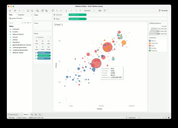
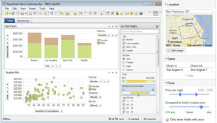
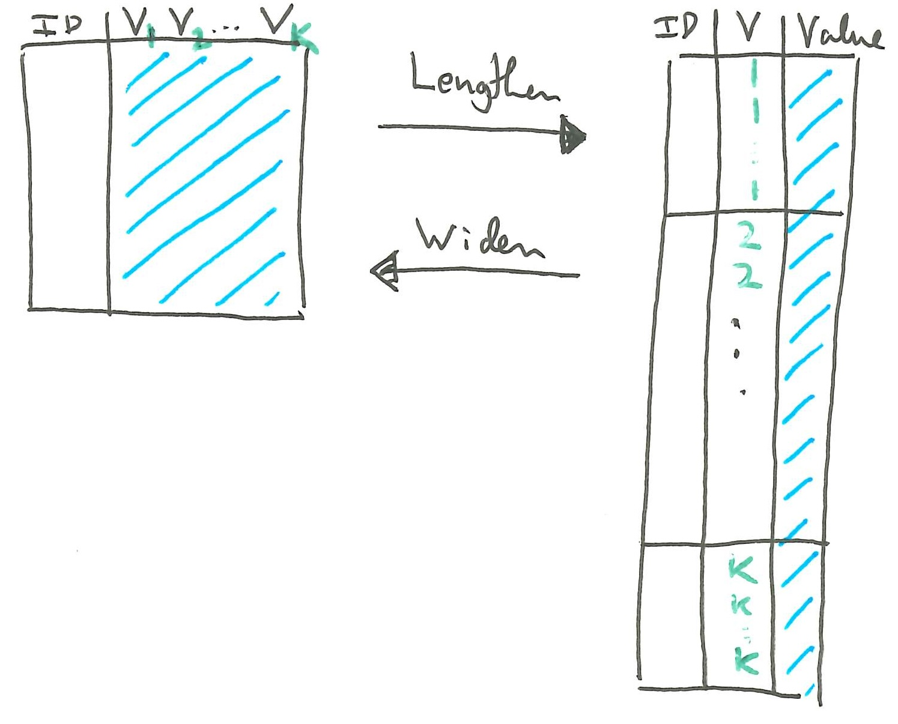
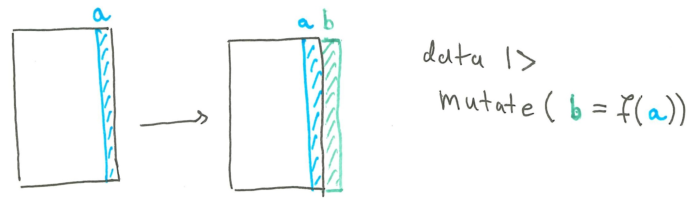
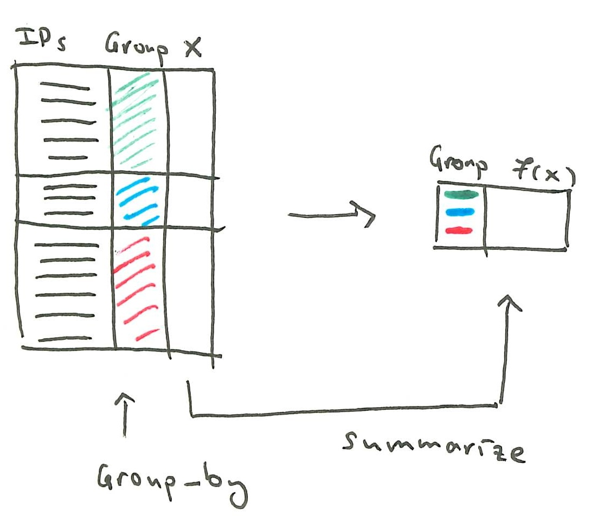
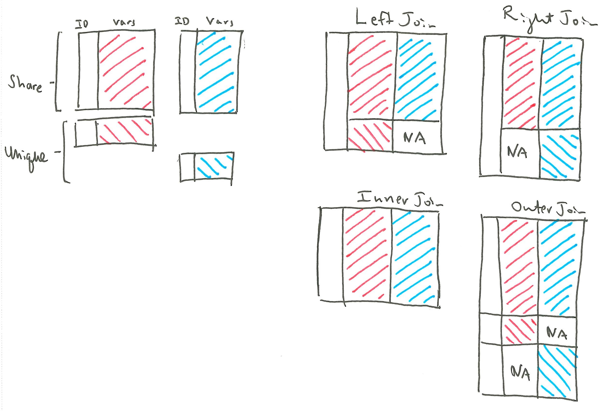
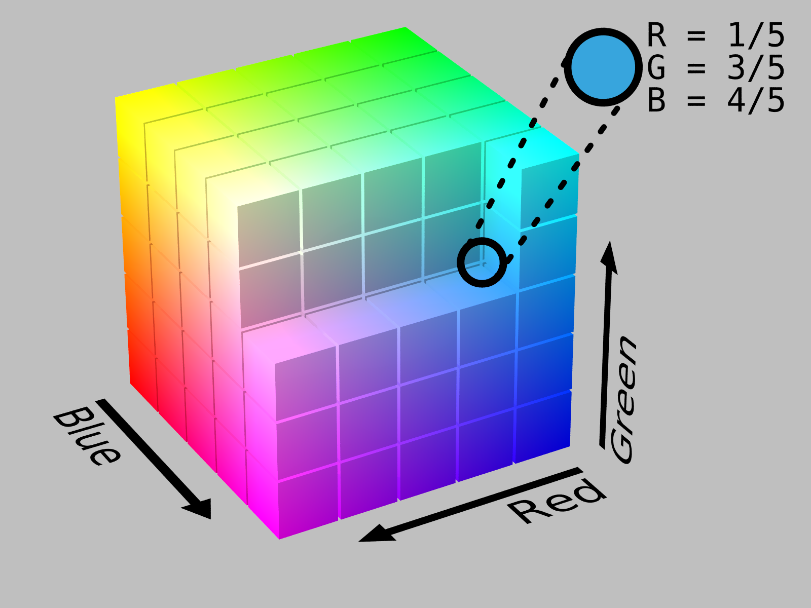
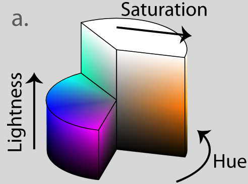

```{r}
#| echo: false
# print a named list of data frames in one row, each labeled by its name
library(tidyverse)
library(knitr)

tables_row <- function(tables, widths = rep(0.95 / length(tables), length(tables))) {
    cell <- function(df, label, width) {
        paste0("<div style='flex: 0 0 ", 100 * width, "%; font-size: 0.85em; text-align: center;'>\n",
               "<em>", label, "</em>\n",
               kable(df, format = "html", table.attr = "class='table table-sm'"), "\n</div>")
    }
    cells <- mapply(cell, tables, names(tables), widths)
    cat("```{=html}",
        "<div style='display: flex; justify-content: space-between; align-items: flex-start;'>",
        cells,
        "</div>",
        "```", sep = "\n")
}
```

## Exam Tips

1. The exam covers the six weeks of material. Expect roughly one problem per
week.

2. The first few problems will be multiple true/false. No justification is
needed. Think of these as a warm-up.

3. The last few problems will be more challenging. Make sure you give yourself
enough time for solving these. You can get partial credit for answering any
subproblem, and they can be answered independently of one another

4. You do not need to write much in your response to get full credit. In our
solutions, one to two sentences are enough for almost every part. Use lists and
draw tables to organize your answers.  This will allow you to make steady
progress without feeling rushed.

5. Try not to rely too much on your cheat sheet. If there's a detail that might
take time to look up on your sheet, consider skipping that part and coming back
to it at the end.

## Interactivity

### Interaction Taxonomy

6. The two main takeaways of the interaction taxonomy notes are:

   - Not all interactive visualizations are the same. We need to be precise about the purpose of user interactions and how they are implemented.
   - There are only a few common interaction patterns in practice. One common breakdown (and the one used in our reading) appears below.

   ```{=html}
   <style>
   .itree .n { display: flex; align-items: center; }
   .itree .lab { padding: 4px 10px; border: 1px solid #888; border-radius: 4px; background: #f4f4f4; font-size: 0.9em; text-align: center; }
   .itree .kids { position: relative; display: flex; flex-direction: column; margin-left: 20px; }
   .itree .kids::before { content: ''; position: absolute; left: -20px; top: 50%; width: 20px; border-top: 1px solid #888; }
   .itree .kids > .n { position: relative; padding: 6px 0 6px 20px; }
   .itree .kids > .n::before { content: ''; position: absolute; left: 0; top: 50%; width: 20px; border-top: 1px solid #888; }
   .itree .kids > .n::after { content: ''; position: absolute; left: 0; top: 0; bottom: 0; border-left: 1px solid #888; }
   .itree .kids > .n:first-child::after { top: 50%; }
   .itree .kids > .n:last-child::after { bottom: 50%; }
   .itree .leaf { display: flex; align-items: center; gap: 12px; }
   .itree .leaf .lab { width: 90px; flex: none; }
   .itree .leaf .media { width: 170px; flex: none; text-align: center; }
   .itree .leaf .media img, .itree .leaf .media video { max-width: 170px; max-height: 130px; border: 1px solid #ccc; }
   .itree .leaf .cap { font-size: 0.8em; color: #555; max-width: 190px; }
   </style>

   <div class="itree">
   <div class="n"><div class="lab">root</div>
   <div class="kids">

   <div class="n"><div class="lab">data and view<br>specification</div>
   <div class="kids">
   <div class="n"><div class="leaf"><div class="lab">visualize</div>
   <div class="media"></div>
   <div class="cap">Decide on a set of visual encodings.</div></div></div>
   <div class="n"><div class="leaf"><div class="lab">filter</div>
   <div class="media"></div>
   <div class="cap">Modify which samples are shown.</div></div></div>
   <div class="n"><div class="leaf"><div class="lab">sort</div>
   <div class="media"><video src="figures/interaction_tree/sort.mp4" poster="figures/interaction_tree/sort.jpg" autoplay muted loop playsinline></video></div>
   <div class="cap">Reorder where the samples appear on the display.</div></div></div>
   <div class="n"><div class="leaf"><div class="lab">derive</div>
   <div class="media"><video src="figures/interaction_tree/derive.mp4" poster="figures/interaction_tree/derive.jpg" autoplay muted loop playsinline></video></div>
   <div class="cap">Introduce new variables to the display.</div></div></div>
   </div></div>

   <div class="n"><div class="lab">view<br>manipulation</div>
   <div class="kids">
   <div class="n"><div class="leaf"><div class="lab">select</div>
   <div class="media"><video src="figures/interaction_tree/select.mp4" poster="figures/interaction_tree/select.jpg" autoplay muted loop playsinline></video></div>
   <div class="cap">Select items to focus or operate on.</div></div></div>
   <div class="n"><div class="leaf"><div class="lab">navigate</div>
   <div class="media"><video src="figures/interaction_tree/navigate.mp4" poster="figures/interaction_tree/navigate.jpg" autoplay muted loop playsinline></video></div>
   <div class="cap">Navigate the view to a region of interest.</div></div></div>
   <div class="n"><div class="leaf"><div class="lab">coordinate</div>
   <div class="media"><video src="figures/interaction_tree/coordinate.mp4" poster="figures/interaction_tree/coordinate.jpg" autoplay muted loop playsinline></video></div>
   <div class="cap">Coordinate interactions across related panels.</div></div></div>
   <div class="n"><div class="leaf"><div class="lab">organize</div>
   <div class="media"></div>
   <div class="cap">Organize views into an easier to understand layout.</div></div></div>
   </div></div>

   <div class="n"><div class="lab">analysis process<br>and provenance</div></div>

   </div></div>
   </div>
   ```


7. To evaluate whether an interactive visualization is good, you can use these principles,

   - **The gulfs of interaction**.
        - Execution $\to$ How long does it take to specify a query and update the display?
        - Evaluation $\to$ How long does it take to understand the updated display?
   - **Eyes beat memory**. Compared to small multiples, interactive visualizations have a higher cognitive load but take up less space.
   - **Object constancy**. Any animated transitions should track the same object.

### Mosaic

8. To read Mosaic code, I answer these questions in order:
    - What is the overall arrangement of plots or interface elements? I would deliberately ignore anything that seems like stylistic customization.
    - Ignoring interactivity, what are the data, marks, and graphical encodings in each?
    - What user inputs are available? Are they outside the plot (e.g., sliders) or built directly into the plot (e.g., brush)?
    - What `Param` or `Selection` variables are used to store the user inputs?
    - How does the plot responds to those user inputs?

   After I've walked through this, I should be able to explain what the plot
   shows and how information flows from the user making an input to the plot
   updating in response. For concreteness, let's consider this example.

   ```js
   filter = vg.Selection.intersect()

   species_menu_3 = vg.menu({as: filter, from: "penguins", column: "species", label: "Species"})
   island_menu = vg.menu({as: filter, from: "penguins", column: "island", label: "Island"})
   species_island_plot = vg.plot(
       vg.dot(
           vg.from("penguins"),
           {x: "bill_length_mm", y: "bill_depth_mm", fill: "species"}
       ),
       vg.highlight({by: filter, opacity: 0.1}),
       vg.xDomain([30, 60]),
       vg.yDomain([12, 22]),
       vg.width(500),
       vg.height(300)
   )

   vg.vconcat([vg.hconcat([species_menu_3, island_menu]), species_island_plot])
   ```

9. For the overall arrangement, I see whether there are any `vg.hconcat` or
`vg.vconcat` calls. Whatever is in the arguments of these functions will be the
main inputs or visualization panels of the plot.

10. For the data, marks, and graphical encodings, I look for layers like
`vg.dot` (scatterplots), `vg.bar` (bar plots), or `vg.line()` (line plot). The
name of the layer itself specifies the mark. Its first argument specifies the
data, and the second argument, a kind of dictionary (between `{}` symbols, like
`{x: "var1", y: "var2"}`), specifies the graphical encoding.

11. To work through the last few steps, let's briefly review how mosaic handles
interactivity. The interactivity code has three jobs,

    - Read in user inputs.
    - Store the user inputs.
    - Update the visualization based on user inputs.

    The reason things get complicated is that in real world interactive
    visualizations there are many ways to do each step. But there are a few
    common patterns that tend to appear again and again, and Mosaic provides
    shorthand for implementing those patterns.

12. To read in user inputs^[It's a bit confusing at first, but interactors are still a type of input.], Mosaic provides either Inputs or Interactors.

    - Inputs are elements on the user interface outside the plot. These are the
    inputs that appear in the "Interactive Visualization -- Part 1" notes.
    - Interactors read in input by directly interacting with the plot. These
    appeared in the "Interactive Visualization -- Part 2" notes.

    When reading code to answer the fourth question, I would scan the code _outside_
    the marks layers, to see if any Inputs are present: `vg.menu`, `vg.slider`,
    `vg.search`, `vg.table`. Then I would scan the code _inside_ the marks layers to
    see if any interactors are present: `vg.interval*`, `vg.toggle*`, `vg.nearest`,
    `vg.panZoom`.

13. `Param` and `Selection` variables are used to store the user inputs.
`Param`s update the graphical marks directly, without ever referring to
particular rows of the data. E.g., it could be used to set the size or color of all
the points. Selections form a query related to the underlying dataset and tells
us which rows are _selected_ by that query. E.g., it can be used to find all the
Airbnbs that are below a certain price.

    Here is an example problem I was considering putting on
    the midterm,

    > For each of the situations below, circle whether a mosaic `Param` or `Selection`
    > applies. You may select one, both, or neither in each part.
    >
    > a. PARAM SELECTION You plan to overlay a 2D density on a scatterplot and would like a slider that allows the user to adjust the bandwidth.
    > b. PARAM SELECTION You want to create a scatterplot of column A vs. column B in a dataset, where both A and B are selected through separate drop-down menus.
    > c. PARAM SELECTION A scatter plot shows daily maximum temperature across the year, and a bar plot shows the number of sunny, rainy, and snowy days. Clicking a bar filters the scatter plot to days with that weather type.
    > d. PARAM SELECTION Brushing a scatterplot of Airbnb rental locations updates a table displaying details of each property.

14. In all our examples, we declare these variables at the very start. The
variables appear in both the inputs (e.g., `vg.menu`) and the layers that
implement the response (e.g., `vg.highlight`, discussed below).  When I'm
reading the mosaic part, I would look for these "storage" variables in both
places.  This tells me how the variable keeps track of the user input and passes
it along to update the view.

15. A subtlety with `Selection` is that different user inputs can conflict with
each other. For example, the brush might select one region in the map, and a
menu might select only the one-room rentals. To reconcile the conflicts, mosaic
requires us to specify whether the selection is a `vg.Selection.intersect()`,
`vg.Selection.union()`, or `vg.Selection.single()`.

    ```{=html}
    <svg viewBox="0 0 1060 220" style="width: 100%; max-width: 900px; display: block; margin: 0 auto;" font-family="monospace" font-size="16" text-anchor="middle">
      <defs>
        <clipPath id="venn-clip-a"><circle cx="100" cy="130" r="65"/></clipPath>
      </defs>
      <g stroke="#0c0c0c" stroke-width="1.5" fill="#f4f4f4">
        <circle cx="100" cy="130" r="65"/><circle cx="180" cy="130" r="65"/>
        <circle cx="420" cy="130" r="65"/><circle cx="500" cy="130" r="65"/>
        <circle cx="740" cy="130" r="65"/><circle cx="820" cy="130" r="65"/>
      </g>
      <circle cx="180" cy="130" r="65" fill="#4682b4" stroke="#0c0c0c" stroke-width="1.5" clip-path="url(#venn-clip-a)"/>
      <g fill="#4682b4" stroke="#0c0c0c" stroke-width="1.5">
        <circle cx="420" cy="130" r="65"/><circle cx="500" cy="130" r="65"/>
        <circle cx="820" cy="130" r="65"/>
      </g>
      <text x="140" y="30">vg.Selection.intersect()</text>
      <text x="460" y="30">vg.Selection.union()</text>
      <text x="780" y="30">vg.Selection.single()</text>
      <text x="895" y="135" text-anchor="start">&lt;- most recent</text>
    </svg>
    ```

16. For how the plot responds, it depends on whether the input was a `Param` or
`Selection`. If it was a Param, we directly manipulate the graphical encoding
inside the `{}` symbols.

    ```js
    color = a Param object

    vg.plot(
        ...
        vg.dot(
            // dataset goes here,
            {x: "var1", y: "var2", fill: color} // graphical encoding depends on Param
        )
    )
    ```

    If it was a Selection, we can either filter the dataset or highlight the
    samples. This is the filtering approach.

    ```js
    current_rentals = a Selection object

    vg.plot(
        ...
        vg.dot(
            vg.from("rentals", filterBy: {current_rentals})
            // graphical encoding goes here
        )
    )
    ```

    This is the highlighting approach.

    ```js
    current_rentals = a Selection object

    vg.plot(
        ...
        vg.dot(
            // dataset goes here
            // graphical encoding goes here
        ),
        vg.highlight({by: current_rentals})
    )
    ```

    In the three examples above, I haven't written the Input or Interactor that is
    used to update the storage variable. I've tried to focus on just the parts
    relevant to the visualization's response to the input, but the real code would
    need these ways of reading in input and updating the `Param` or `Selection`.

17. Let's practice working through these steps with this more involved example
from the notes.

    ```js
    weather_type_v3 = vg.Selection.single()
    months_v3 = vg.Selection.intersect()

    vg.vconcat(
      vg.plot(
        vg.dot(
          vg.from("weather", {filterBy: weather_type_v3}),
          {
            x: vg.dateMonthDay("date"),
            y: "temp_max",
            fill: "weather",
            r: "precipitation"
          }
        ),
        vg.intervalX({as: months_v3}),
        vg.highlight({by: months_v3, fill: "#ccc", fillOpacity: 0.2}),
        vg.colorLegend({as: weather_type_v3}),
        vg.xyDomain(vg.Fixed),
        vg.colorDomain(domain),
        vg.colorRange(colors),
        vg.rDomain(vg.Fixed),
        vg.rRange([2, 10])
      ),
      vg.plot(
        vg.barX(
          vg.from("weather"),
          {x: vg.count(), y: "weather", fill: "#ccc", fillOpacity: 0.2}
        ),
        vg.barX(
          vg.from("weather", {filterBy: months_v3}),
          {x: vg.count(), y: "weather", fill: "weather"}
        ),
        vg.toggleY({as: weather_type_v3}),
        vg.highlight({by: weather_type_v3}),
        vg.xDomain(vg.Fixed),
        vg.yDomain(domain),
        vg.yLabel(null),
        vg.colorDomain(domain),
        vg.colorRange(colors)
      )
    );
    ```

## Data Management

18. You should be able to explain whether or not a dataset is tidy. If it's
implicitly storing variables in the column names, then it is not tidy. If it's
storing two types of variables within a single column, then it's also not tidy.

19. There were a few kinds of operations we used to make data tidy for
visualization. You should be able to explain conceptually what they do and also
combine them in the necessary ways to transform data.

20. These are the main operations you should know.

    - **Pivoting wider** spreads one column into many different columns. **Pivoting longer**
    stacks many columns into one and introduces a new variable to explicitly
    track what had been implicitly stored in the column names. They are
    implemented in the `pivot_wider` and `pivot_longer` functions, respectively.

    {width=350}

    - **Deriving** a column introduces a new column based on existing columns.
    This is implemented by `mutate`. **Aggregation** replaces a column (or
    columns) with group-level summary statistics. This is implemented by the
    `group_by` and `summarize` functions placed one after the other. The output
    has one row per group.

    {width=450}

    {width=300}

    - **Filtering** keeps only the rows based on the data value. **Selecting**
    keeps only the columns based on their name.

    - **Joining** merges two tables into one using the variables that are shared
    across them. Since an ID could be present in only one of the two tables, we
    needed different types of join (`left_join`, `right_join`, `full_join`,
    `inner_join`).

    {width=500}

21. The skill I want to make sure you've developed is that you can recognize how
the transformations can be applied in a sequence to achieve a desired data
format. I've modified one of the exercises from our exercise sheet to
deprioritize writing code from scratch and instead emphasize noticing the types
of transformations that are needed.

    > The dataframe `df` contains the habits of readers in a hypothetical
    reading group. Each row is one book read by one reader. For each part,
    describe how to transform the data from the Before to the After format.
    Clearly indicate if it requires multiple steps. Your answers can be very
    brief (e.g., "step 1. filter to rows with rating above 3"). Each part is
    independent of the others.
    ```{r q4-setup, echo = FALSE, cache = FALSE}
    df <- data.frame(
        person_id = rep(c(501, 502), each = 4),
        genre = c("Mystery", "Mystery", "Sci-Fi", "History", "Sci-Fi", "Sci-Fi", "History", "Mystery"),
        pages_read = c(300, 240, 350, 280, 400, 150, 330, 210),
        days_taken = c(12, 6, 10, 14, 8, 10, 15, 7),
        rating = c(4, 5, 3, 2, 5, 4, 3, 4)
    )
    ```
    >
    > a. Total pages read by each reader within each genre.

    ```{r q4-bookstore-a, echo = FALSE, cache = FALSE, results = "asis"}
    tables_row(list(
        Before = df,
        After = df |>
            group_by(person_id, genre) |>
            summarise(total_pages = sum(pages_read), .groups = "drop")
    ), widths = c(0.5, 0.4))
    ```

    > b. Reading pace for each book.

    ```{r q4-bookstore-b, echo = FALSE, cache = FALSE, results = "asis"}
    tables_row(list(
        Before = select(df, -rating),
        After = df |>
            select(-rating) |>
            mutate(pace = pages_read / days_taken)
    ), widths = c(0.40, 0.50))
    ```

    > c. Each reader's average rating in each genre.

    ```{r q4-bookstore-c, echo = FALSE, cache = FALSE, results = "asis"}
    tables_row(list(
        Before = df,
        After = df |>
            group_by(person_id, genre) |>
            summarise(rating = mean(rating), .groups = "drop") |>
            pivot_wider(names_from = genre, values_from = rating)
    ), widths = c(0.5, 0.4))
    ```

## Color

22. There were three main parts in this lecture,

    - We introduced RGB and HSL color spaces. This helped us understand what color is and how it's represented in a computer.
    - We defined color maps, reviewed different types of color map, and pointed to functions that can be used to implement them.
    - We went over some best practices. These are recommendations from the literature that we can use to improve upon ggplot2 defaults.

23. Color spaces are numerical representations of color. RGB represented color as
a mixture of red, green, and blue components. When you enter strings like
"#F00000" in code, that is the RGB representation.  HSL represented color using
hue, saturation, and lightness. This was useful for making sense of color
wheels. We had two diagrams to summarize these color spaces.

    ::: {layout-ncol=2}
    

    
    :::

    An important aspect of HSL representation is that saturation and luminance are
    naturally perceived as being ordered. Hue is not, which is why when using it to
    encode data (rainbow palettes) it requires more cognitive effort.

24. Color maps are ways of mapping data attributes to color. We could organize
them according to (i) the data that they're supposed to encode and (ii) the
mapping from the data to the color space. These are all the color maps that we
discussed. The first  are more important because even if we only have them, we
can cover all the Types, Directions, and Continuity options. The rest are nice
presets provided by the community, but they are not as essential to recognize.

    ```{r}
    #| echo: false
    #| results: asis
    library(RColorBrewer)
    library(scico)
    library(biscale)

    # a continuous scale is drawn as a CSS gradient, everything else as blocks
    strip <- function(cols, continuous = FALSE) {
        if (continuous) {
            return(sprintf("<span style='display:inline-block;vertical-align:middle;width:120px;height:16px;background:linear-gradient(to right,%s);'></span>",
                           paste(cols, collapse = ",")))
        }
        blocks <- sprintf("<span style='display:inline-block;vertical-align:middle;width:24px;height:16px;background:%s;'></span>", cols)
        paste(blocks, collapse = "")
    }

    grid3 <- function(pal) {
        cells <- unlist(lapply(3:1, \(y) pal[paste0(1:3, "-", y)]))
        blocks <- sprintf("<span style='background:%s;'></span>", cells)
        paste0("<span style='display:inline-grid;vertical-align:middle;grid-template-columns:repeat(3,16px);grid-auto-rows:16px;'>",
               paste(blocks, collapse = ""), "</span>")
    }

    grad <- seq(0, 1, length.out = 100)
    bin_mid <- \(n) (seq_len(n) - 0.5) / n

    white_blue <- scales::seq_gradient_pal("white", "#1f78b4")
    blue_red <- scales::div_gradient_pal("#2166AC", "white", "#B2182B")
    blues <- scales::gradient_n_pal(brewer.pal(7, "Blues"))

    tribble(
        ~fn,                      ~type,         ~direction,             ~continuity,  ~package,    ~example,
        "scale_color_manual",     "Categorical", "NA",                   "NA",         "ggplot2",   strip(c("#E41A1C", "#377EB8", "#4DAF4A")),
        "scale_color_gradient",   "Ordered",     "Sequential",           "Continuous", "ggplot2",   strip(white_blue(grad), TRUE),
        "scale_color_steps",      "Ordered",     "Sequential",           "Stepped",    "ggplot2",   strip(white_blue(bin_mid(5))),
        "scale_color_gradient2",  "Ordered",     "Diverging",            "Continuous", "ggplot2",   strip(blue_red(grad), TRUE),
        "scale_color_steps2",     "Ordered",     "Diverging",            "Stepped",    "ggplot2",   strip(blue_red(bin_mid(5))),
        "scale_color_brewer",     "Categorical", "NA",                   "NA",         "ggplot2",   strip(brewer.pal(5, "Set1")),
        "scale_color_viridis_c",  "Ordered",     "Sequential",           "Continuous", "ggplot2",   strip(viridisLite::viridis(100), TRUE),
        "scale_color_viridis_b",  "Ordered",     "Sequential",           "Stepped",    "ggplot2",   strip(viridisLite::viridis(5)),
        "scale_color_distiller",  "Ordered",     "Sequential",           "Continuous", "ggplot2",   strip(blues(grad), TRUE),
        "scale_color_fermenter",  "Ordered",     "Sequential",           "Stepped",    "ggplot2",   strip(brewer.pal(5, "Blues")),
        "scale_color_scico",      "Ordered",     "Depends", "Continuous", "scico",
            paste(strip(scico(100, palette = "batlow"), TRUE), strip(scico(100, palette = "vik"), TRUE), sep = "<br>"),
        "bi_scale_color",         "Ordered (two variables)", "Neither, bivariate", "Stepped", "biscale", grid3(bi_pal("DkBlue", dim = 3, preview = FALSE))
    ) |>
        mutate(fn = paste0("`", fn, "`")) |>
        select(
            `Function` = fn,
            `Type` = type,
            `Direction` = direction,
            `Continuity` = continuity,
            `Package` = package,
            `Example` = example
        ) |>
        kable(format = "pipe") |>
        cat(sep = "\n")
    ```

25. There were many best practices, but the one that comes up the most in
practice is that we should not use too many colors in categorical color maps.
The maximum recommended ranged from 6 to 12, though it depended on details like
how much space the color marks take up. The two solutions we discussed were
either (i) coarsen the categories so that there are fewer of them or (ii) lump
the rare categories into an "other" category.

26. We discussed that there are different forms of color blindness and that they
make several points in a color space appear equivalent. We mentioned that there
are both R functions and online resources to see how color palettes appear under
each of these forms of color blindness, so that color maps can be chosen which
will not be ambiguous to colorblind readers.